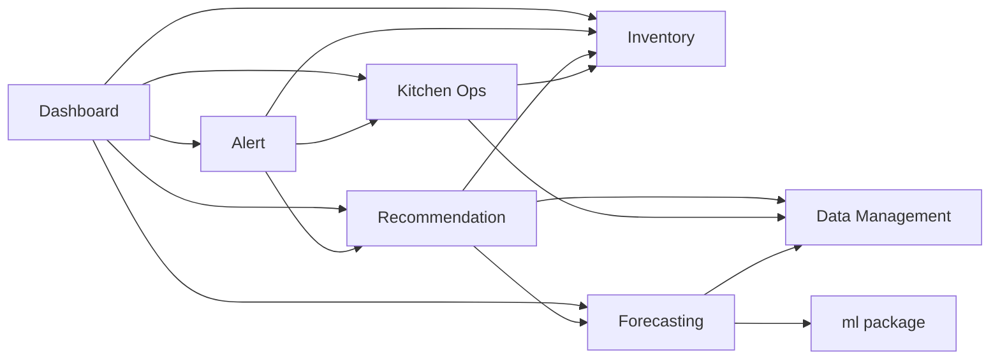
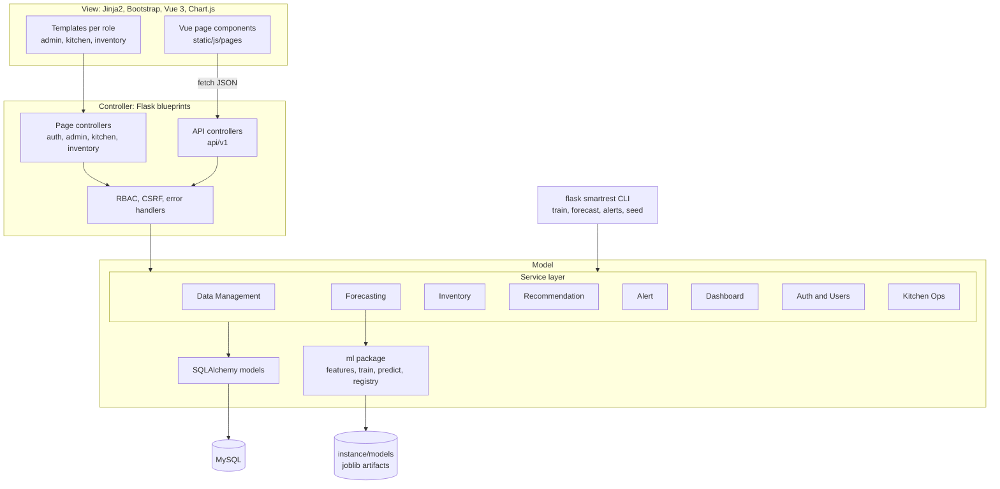
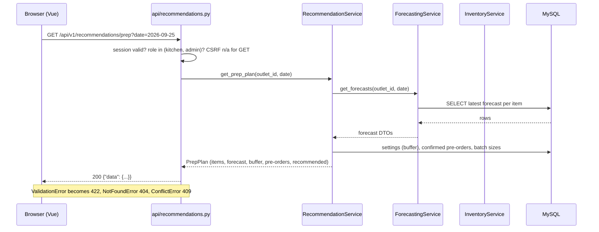
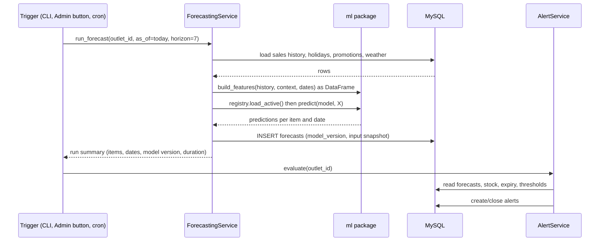

# SmartRestaurant: Architecture

Read `REQUIREMENTS.md` first (story IDs such as K3 or S1 are used below).

## 0. Assumptions and decisions

| # | Assumption / decision |
|---|---|
| D1 | Fixed by the proposal: Python + Flask, MySQL, REST, Pandas, scikit-learn, XGBoost, HTML/CSS/JS/Bootstrap. Strict MVC as instructed. |
| D2 | Flask **application factory** with **blueprints**. One deployable app: it serves HTML pages and the JSON API. No separate frontend server. |
| D3 | **Vue 3 via CDN, no build step** (requirements A13). Flask renders the page shell, and Vue fetches JSON from `/api/v1`. Vue and Bootstrap files are **vendored into `static/vendor/`** so the demo does not depend on venue Wi-Fi. |
| D4 | ORM: Flask-SQLAlchemy + Flask-Migrate. Auth: Flask-Login session cookie for pages and API, CSRF via Flask-WTF. No JWT. |
| D5 | **Services are the transaction boundary.** Controllers never commit. Services validate (NFR8), open and commit the transaction, and raise domain exceptions. |
| D6 | **No background workers** (no Celery/Redis). Forecast runs, alert runs and training are Flask CLI commands (`flask smartrest ...`), also exposed as admin "Run now" buttons. On a server, cron can call the same commands. |
| D7 | Business dates are `DATE` in **Asia/Colombo**; timestamps are stored in UTC. |
| D8 | Tests: service unit tests on SQLite in-memory; integration and API tests on a MySQL test database. Models avoid MySQL-only types. |
| D9 | Notification means **in-app alerts only**. No email/SMS (not in the proposal, so out of scope). |
| D10 | Eight services: the six from the Gantt chart plus two the Gantt omits (Auth & Users, Kitchen Operations). See section 3. |

---

## 1. MVC layers

| Layer | What it is here | May contain | Must not contain |
|---|---|---|---|
| **Model** | SQLAlchemy models (`app/models`), the **service layer** (`app/services`), and the **ML package** (`app/ml`, callable only from `ForecastingService`) | Tables, business rules, calculations, ML, validation, transactions | Anything that knows about `request`, `session`, HTTP codes, or templates |
| **View** | Jinja2 templates (`app/templates`), Bootstrap, Vue components and Chart.js (`app/static`) | Layout, display formatting, calling `/api/v1` from JS | Business rules, SQL, forecast or stock arithmetic |
| **Controller** | Flask blueprints (`app/controllers`) | Parse request, check role, call **one** service method, pick response (template or JSON), map exceptions to HTTP status | Queries, calculations, ML calls, `db.session.commit()` |

### Dependency rules (enforced by `tests/test_architecture.py`)

| Module | May import | Must not import |
|---|---|---|
| `controllers/*` | `services`, `utils`, `flask` | `models`, `ml`, `sqlalchemy` |
| `services/*` | `models`, other services (downward only, section 3), `ml` (**only** `forecasting_service`), `utils` | `flask.request`, `flask.session`, `controllers` |
| `ml/*` | `pandas`, `sklearn`, `xgboost`, `joblib`, `utils` | `flask`, `models`, `services` (data is passed in as DataFrames) |
| `models/*` | `extensions`, `sqlalchemy` | anything above |
| `templates/*` | (rendered data only) | any query or business logic |

`ml/` takes DataFrames in and returns DataFrames out. It never touches the DB, so it can be trained and tested from a notebook with no Flask.

The architecture test scans `import` lines and fails the build on a violation. This is the enforcement of "controllers hold no business logic" that a reviewer can actually run.

---

## 2. Folder structure

```
smartrest/
├── app/
│   ├── __init__.py              # create_app(): config, extensions, blueprints, error handlers
│   ├── config.py                # DevConfig / TestConfig / ProdConfig (values from env)
│   ├── extensions.py            # db, migrate, login_manager, csrf
│   ├── cli.py                   # flask smartrest seed | generate-data | train | forecast | alerts | ...
│   ├── seed/                    # catalog.py (menu, ingredients, recipes), generate.py (synthetic data); called by cli.py, calls services only
│   │
│   ├── models/                  # MODEL: tables only, no business logic
│   │   ├── base.py              #   OutletScopedMixin, timestamps mixin
│   │   ├── user.py              #   Outlet, User, LoginAttempt, AuditLog   (roles are a CHECK value, not a table)
│   │   ├── menu.py              #   MenuItem, RecipeLine
│   │   ├── inventory.py         #   Ingredient, Supplier, PurchaseOrder(+Line), StockBatch, StockMovement
│   │   ├── sales.py             #   SalesRecord, PreOrder
│   │   ├── context.py           #   Holiday, Promotion, PromotionItem, WeatherDaily
│   │   ├── kitchen.py           #   PreparationRecord, FoodWaste
│   │   └── forecast.py          #   ModelVersion, ForecastRun, Forecast, Recommendation, Alert, Setting
│   │
│   ├── services/                # MODEL: business logic (one class per service)
│   │   ├── auth_service.py              # users, roles, login checks, lockout
│   │   ├── data_management_service.py   # sales import, contextual data, menu, recipes, validation
│   │   ├── forecasting_service.py       # runs/stores forecasts; the ONLY caller of app/ml
│   │   ├── inventory_service.py         # ingredients, stock movements, FEFO batches, POs, suppliers, requests
│   │   ├── kitchen_service.py           # prepared / served / waste, orders, pre-orders, availability
│   │   ├── recommendation_service.py    # prep quantities, ingredient requirements, reorder suggestions
│   │   ├── alert_service.py             # evaluates rules, creates/dedupes/closes alerts
│   │   ├── dashboard_service.py         # read-only aggregates for dashboards, analytics, reports
│   │   └── errors.py                    # ValidationError, NotFoundError, ConflictError
│   │
│   ├── ml/                      # MODEL: pure ML code, no Flask, no DB
│   │   ├── features.py          #   build_features(): same code for training and inference
│   │   ├── train.py             #   fit + compare models, time-based split
│   │   ├── evaluate.py          #   MAE, RMSE, MAPE, R2, naive baseline
│   │   ├── predict.py           #   predict(model, features)
│   │   └── registry.py          #   save/load joblib artifacts, active-version cache
│   │
│   ├── controllers/             # CONTROLLER: blueprints
│   │   ├── auth.py              #   /login, /logout
│   │   ├── admin.py             #   pages under /admin/*
│   │   ├── kitchen.py           #   pages under /kitchen/*
│   │   ├── inventory.py         #   pages under /inventory/*
│   │   └── api/                 #   JSON under /api/v1/*
│   │       ├── data.py          #     sales, context, menu, recipes, import
│   │       ├── forecasts.py     #     forecasts, model versions, runs
│   │       ├── recommendations.py
│   │       ├── kitchen.py       #     prepared, served, waste, orders, requests
│   │       ├── inventory.py     #     ingredients, movements, batches, suppliers, POs
│   │       ├── alerts.py
│   │       ├── dashboards.py    #     dashboard, analytics, report data
│   │       └── users.py
│   │
│   ├── utils/
│   │   ├── security.py          #   roles_required(), current_outlet_id()
│   │   ├── responses.py         #   JSON envelope, error handlers
│   │   └── dates.py             #   Colombo date helpers
│   │
│   ├── templates/               # VIEW
│   │   ├── base.html            #   layout, nav per role, CSRF meta tag
│   │   ├── auth/login.html
│   │   ├── admin/…   kitchen/…   inventory/…
│   │   ├── errors/403.html 404.html 500.html
│   │   └── partials/            #   alert badge, table, form macros
│   └── static/
│       ├── css/app.css
│       ├── js/pages/            #   one Vue mount script per page
│       ├── js/api.js            #   fetch wrapper: CSRF header, error handling
│       └── vendor/              #   vue, bootstrap, chart.js (vendored, no CDN at demo time)
│
├── migrations/                  # Alembic (Flask-Migrate)
├── data/
│   ├── holidays_lk.csv          # Poya, public and school holidays (curated)
│   └── synthetic/               # generated CSVs (git-ignored)
├── instance/models/             # trained model artifacts (git-ignored)
├── tests/
│   ├── unit/  integration/  api/
│   └── test_architecture.py     # import-rule enforcement
├── docs/                        # this documentation set
├── .env.example  requirements.txt  wsgi.py  README.md  CLAUDE.md
└── docker-compose.yml           # optional: mysql + app
```

---

## 3. The six Gantt services, plus two

| # | Service (Gantt) | Model layer | Controller | View | Depends on |
|---|---|---|---|---|---|
| 1 | **Data Management** (sales import, contextual data) | `data_management_service`; models `SalesRecord`, `Holiday`, `Promotion`, `WeatherDaily`, `MenuItem`, `RecipeLine` | `controllers/api/data.py`; admin pages for import and master data | Admin import, menu, recipe pages | none |
| 2 | **Demand Forecasting** (RF/XGBoost) | `forecasting_service` + `app/ml/*`; models `ModelVersion`, `Forecast` | `controllers/api/forecasts.py` | Forecast tables and charts (all roles) | Data Management |
| 3 | **Inventory** (stock, shelf life) | `inventory_service`; models `Ingredient`, `StockBatch`, `StockMovement`, `Supplier`, `PurchaseOrder`, `StockRequest` | `controllers/inventory.py`, `api/inventory.py` | Inventory dashboard and pages | none |
| 4 | **Recommendation** (prep and purchasing) | `recommendation_service`; model `Recommendation` | `controllers/api/recommendations.py` | Prep plan, ingredient needs, reorder list | Forecasting, Inventory, Data Management |
| 5 | **Alert / Notification** (stock-out, waste risk) | `alert_service`; model `Alert` | `controllers/api/alerts.py` | Alert badge and lists on every dashboard | Recommendation, Inventory, Forecasting, Kitchen Ops |
| 6 | **Dashboard** (dashboards, API integration) | `dashboard_service` (read-only aggregation, no tables of its own) | `controllers/admin.py`, `kitchen.py`, `inventory.py` pages, `api/dashboards.py` | The three role dashboards, analytics, reports | all of the above (read only) |
| + | **Auth & Users** (not in Gantt) | `auth_service`; models `User`, `Role`, `AuditLog` | `controllers/auth.py`, `api/users.py` | Login, user admin | none |
| + | **Kitchen Operations** (not in Gantt) | `kitchen_service`; models `PreparationRecord`, `FoodWaste`, `Order`, `PreOrder` | `controllers/kitchen.py`, `api/kitchen.py` | Kitchen record forms | Data Management, Inventory |

The Gantt omits Auth and Kitchen Operations, yet FR1, FR8 and most kitchen stories (K5-K7, K10-K13) need them. They're added here, and `PLAN.md` will schedule them.

Dependency direction is strictly downward (no cycles):



Rule: a service may call only services to its right in this graph. A cycle is a design bug.

---

## 4. Component overview



---

## 5. Request flows

### 5.1 Page request

1. Browser requests `GET /kitchen/prep` with the session cookie.
2. The `kitchen` blueprint's `before_request` runs `roles_required("kitchen")`. Not logged in gives a redirect to `/login`; the wrong role gives `403`.
3. The controller renders `kitchen/prep.html`, which is only a shell, with a mount point and, where cheap, initial data from a service call embedded via `{{ data|tojson }}` (never `|safe`).
4. Vue starts and calls the JSON API for live data.

### 5.2 API request



A write (for example `POST /api/v1/kitchen/prepared`) adds a CSRF token check (`X-CSRFToken` header). The service validates (C4), writes and commits in one transaction. The controller only translates the result.

### 5.3 Response envelope

Success: `{"data": ..., "meta": {...}}`. Error: `{"error": {"code": "validation_error", "message": "...", "fields": {"quantity": "must be > 0"}}}`. Full shapes are in `API.md`.

---

## 6. How the ML component is called



Rules:

- `ForecastingService` is the **only** caller of `app/ml`. Controllers and other services call `ForecastingService` methods (`run_forecast`, `get_forecasts`, `train_model`, `activate_model`).
- **Training and inference share `build_features()`**, which prevents train/serve skew (NFR6).
- **Inference is fast (NFR2, S1).** The active model is loaded once per worker with joblib and cached. A 7-day run for ~10 items is 70 rows, so it takes milliseconds. Each call compares the active version id in `model_versions` with the cached one, and reloads if they differ (this is how "activate" takes effect across workers).
- **No recursive forecasting.** Features use only lags of 7 days or more, so a 7-day horizon never needs its own predictions as inputs. Details in `ML_PLAN.md`.
- **Training is manual and synchronous** (`flask smartrest train`, or the admin button). Data is small (about 24 months x ~10 items, roughly 7k rows), so it takes seconds to a minute. It compares Random Forest and XGBoost plus the naive baseline on a time-based split, saves each artifact to `instance/models/<version>/`, and writes metrics to `model_versions`. A model becomes active only through an explicit `activate_model` call (A16).
- **Fallback (S5).** If no active model exists or history is too short, `get_forecasts` returns an empty result with a reason, and the UI shows "No forecast yet". It never fabricates a number.
- Every stored forecast records `model_version_id` and a snapshot of holiday, weather and promo inputs (FR11, S1).

---

## 7. Cross-cutting design

### 7.1 Authentication and RBAC (FR1, NFR5)

- Flask-Login session cookie: `HttpOnly`, `SameSite=Lax`, `Secure` in production, 30 minute idle timeout (C3).
- Passwords hashed with Werkzeug's scrypt/pbkdf2 hash. Login lockout (per username and address) and the password rule live in `auth_service`.
- The session id is `user id:session version` (`User.get_id`); the loader refuses an old version, so logout, a password reset or a deactivation ends every copy of the cookie.
- Every response carries a Content-Security-Policy (`script-src 'self' 'unsafe-eval'`: Vue compiles the in-page templates, and there is no inline script), `X-Frame-Options: DENY`, `X-Content-Type-Options: nosniff` and `Referrer-Policy: same-origin`. Uploads are capped at 5 MB (`MAX_CONTENT_LENGTH`). CSV exports prefix text cells that start like a formula with an apostrophe.
- Behind a reverse proxy (for HTTPS) set `TRUST_PROXY` to the number of proxies, so the lockout sees the client's address (Werkzeug `ProxyFix`).
- Each role blueprint sets `before_request` to `roles_required(...)`, so a new route can't be added to a role blueprint without inheriting the check. API controllers use `@roles_required(...)` on each route, and shared read endpoints list their roles explicitly (`API.md`).
- Post-login redirect map: `admin` to `/admin`, `kitchen` to `/kitchen`, `inventory` to `/inventory`.
- Error handlers return JSON for `/api/*` and HTML pages otherwise. A `401` on a page redirects to login.
- Route x role test matrix: `tests/api/test_rbac.py` walks `app.url_map` and asserts each route against each role. A missing decorator is a failing test.

### 7.2 Multi-outlet readiness (NFR7)

- Operational tables carry `outlet_id` (see `DATABASE.md`). The `OutletScopedMixin` supplies the column and index.
- Every service method takes `outlet_id` explicitly. The controller gets it from `current_outlet_id()`, which today returns the user's outlet (always 1), and services never read a global.
- The UI never shows the outlet, so single-restaurant scope is unchanged.

### 7.3 Validation and integrity (NFR8)

- Three lines of defence: (1) form/JS hints for usability, (2) **service-layer validation, the source of truth**, (3) DB constraints (NOT NULL, CHECK, UNIQUE, FK).
- Stock changes lock the affected batch rows (`SELECT ... FOR UPDATE`), so concurrent stock-outs cannot drive stock negative.
- Import (A14) validates the whole file before saving and returns per-row errors.

### 7.4 Error handling (NFR3)

- Services raise `ValidationError`, `NotFoundError` or `ConflictError`. Anything else is a bug and becomes a logged `500` with a friendly page; the user never sees a stack trace.
- Missing data (S5) is a normal return value (empty result plus reason), not an exception.

### 7.5 Frontend pattern (D3)

- Each page template has a root `<div id="app">` and one script in `static/js/pages/`.
- **Delimiter clash:** Jinja and Vue both use `{{ }}`. Vue is configured with `delimiters: ['[[', ']]']`, and the rule is documented in `CLAUDE.md`.
- `static/js/api.js` wraps `fetch`: adds the CSRF header, unwraps the envelope, and shows field errors from a `422`.
- Charts use Chart.js. Rendering logic only; numbers come from the API, so a chart and its table always match.
- Layout is Bootstrap 5 grid, so pages work at 360 px (NFR4). Bootstrap and Vue are vendored.

### 7.6 Configuration, logging, audit

- Secrets and DB URL come from environment variables (`.env`, never committed).
- Python `logging` to console and a rotating file, with a per-request id. Model runs and imports log counts and durations.
- Admin actions (user, role, model activation, import) write an `AuditLog` row (A3, A16).

### 7.7 Deployment

- **Dev:** `python -m venv`, local MySQL, `flask run`.
- **Demo/prod:** gunicorn (2 workers) behind nginx, MySQL on the same host (or `docker-compose.yml` bringing up both). Ubuntu, 2 GB RAM or more. A working local copy is the fallback if the VPS misbehaves (proposal risk "Deployment issues").
- Migrations: `flask db upgrade`. Data setup: `flask smartrest seed` then `generate-data`, then `train`, `forecast`, `alerts`.

---

## 8. Risks and how the design responds

| Risk | Response |
|---|---|
| Only 9 days for one builder | Thin vertical slices, one page per story, no build step, no background workers, no PDF, no separate SPA. |
| Business logic leaking into controllers | `tests/test_architecture.py` import-rule test. |
| Missing RBAC check on a new route | Blueprint-level `before_request` and the route x role test. |
| Forecast and stock data shown inconsistently across pages | Every number comes from one service method; pages and API both call it. |
| Vue and Jinja delimiter conflict | `[[ ]]` delimiters, documented. |
| Venue network failure at demo | Vendored JS/CSS; local fallback copy of the app. |
| ML code tangled with web code | `ml/` has no Flask or DB imports and is called only through `ForecastingService`. |
| SQLite tests hiding MySQL-specific bugs | Integration and API tests run on MySQL. |

## 9. Open points for your review

1. **Eight services instead of six.** Do you accept adding Auth & Users and Kitchen Operations? Without them FR1 and FR8 have no home.
2. **Import-rule test.** It adds about an hour but proves the MVC claim to the examiners. I recommend keeping it.
3. **Run commands, no scheduler.** For the demo, forecasts and alerts are triggered by button or CLI. OK, or do you want a cron job on the server?

## 10. Amendments made during detailed planning

Accepted decisions from section 9: **eight services** (Auth & Users and Kitchen Operations added), the **import-rule test** is kept, and forecasts and alerts run by **CLI or admin button with no scheduler**.

Changes to the model list (details in `DATABASE.md`): `Outlet`, `LoginAttempt`, `ForecastRun` and `PromotionItem` are added; `IngredientWastage` is dropped (ingredient wastage is a `wastage` stock movement, I13); `Order` and `StockRequest` are postponed (see `PLAN.md` section 4).

Alert refresh: because a service may not call a service above it in the graph (section 3), `InventoryService` cannot trigger `AlertService`. Alerts are re-evaluated by CLI, by the admin "Run now", and lazily when alerts or dashboards are read and the last evaluation is over 60 seconds old (`API.md` 3.5, `ML_PLAN.md` B4).

Vue infrastructure (vendored libraries, `api.js`, shared components) is built on day 2, not day 0 (`PLAN.md` section 5).

`app/seed/` is a fifth module group next to `cli.py`: it may import `services` and `utils` (never `models` directly, so seeded data goes through the same validation as user data) and is called only from `cli.py`. `test_architecture.py` covers it.
