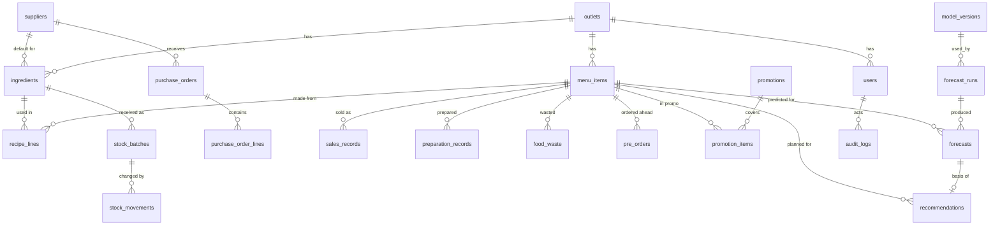

# SmartRestaurant: Database

Read `REQUIREMENTS.md` (story IDs) and `ARCHITECTURE.md` first. Tier labels (M1, M2, S, X) are defined in `PLAN.md`: **M1** core demo loop, **M2** rest of the MVP, **S** stretch, **X** postponed.

## 0. Decisions

| # | Decision |
|---|---|
| DB1 | **DBMS.** The proposal says MySQL. The server used is **MariaDB 11.8**, run as a private instance for this project on port 3307 (`scripts/db.sh`, data under `.mariadb/`, so it never touches the other databases on the machine); it is MySQL-compatible for everything used here (InnoDB, DECIMAL, CHECK, JSON as text). MariaDB reports CHECK failures as OperationalError 4025 and, with snapshot isolation, can fail a locking read with 1020 (services retry). Models use only portable SQLAlchemy types so the same code runs on SQLite (unit tests) and MySQL/MariaDB (integration tests, demo). |
| DB2 | Charset `utf8mb4`, engine InnoDB. Timestamps are UTC `DATETIME`; business dates are `DATE` in Asia/Colombo (ARCH D7). |
| DB3 | Primary keys are integer auto-increment (`BIGINT` on high-volume tables: sales, movements, forecasts, prep, waste). Enumerations are `VARCHAR` plus a `CHECK` constraint (portable; no native ENUM). |
| DB4 | **Money** `DECIMAL(12,2)` (LKR). **Ingredient quantities** `DECIMAL(12,3)`. **Recipe quantities** `DECIMAL(12,4)`. **Portions** (sold, prepared, wasted) are `INT`. **Forecast quantity** is `DECIMAL(10,2)`. No floats for stock or money. |
| DB5 | **`outlet_id` rule (NFR7).** Master and transaction tables carry `outlet_id NOT NULL DEFAULT 1` with an index and FK to `outlets`. Pure child/line tables (`recipe_lines`, `purchase_order_lines`, `promotion_items`) inherit the outlet through their parent and do not repeat it. |
| DB6 | **Stock is derived, never stored as a running total.** Current stock = sum of `stock_batches.qty_remaining`. Every change also writes an immutable `stock_movements` row. Invariant (tested): per ingredient, `SUM(movements.quantity) = SUM(batches.qty_remaining)`. |
| DB7 | **On hand vs usable.** `on_hand` = all remaining batch quantity. `usable` = remaining quantity in batches that are not expired (`expiry_date IS NULL OR expiry_date >= today`). Shortage checks, alerts, reorder and FEFO stock-out use **usable**. Expired stock stays on hand until written off with a `wastage` movement. |
| DB8 | **Recording "prepared" does not auto-deduct ingredients.** Stock falls only through explicit movements (`stock_out`, `wastage`, `adjustment`). Derived usage (prepared x recipe) is a report figure only (K8 postponed). This keeps kitchen and inventory transactions separate. |
| DB9 | Nothing is hard-deleted except line rows replaced inside one transaction (recipe lines). Masters are deactivated with `is_active`. History tables are append-only. |
| DB10 | Alembic constraint naming convention is set on `db.metadata` so migrations are stable across MySQL and SQLite. One initial migration creates every table below (empty tables cost nothing); later slices add migrations only for changes. |
| DB11 | Deviation from ARCH: no `IngredientWastage` table. Ingredient wastage is a `stock_movements` row of type `wastage` (I13, "as a movement type"). `Order` and `StockRequest` are postponed (section 2.7). `Outlet`, `LoginAttempt`, `ForecastRun`, `PromotionItem` are added. |

## 1. Entity overview

Tables not in the diagram (no relations worth drawing): `login_attempts`, `settings`, `holidays`, `weather_daily`, `alerts`.

## 2. Tables

Common columns on every table unless stated: `id`, `created_at`, `updated_at` (UTC). "M1/M2/S" says when the feature that writes the table is built.

### 2.1 Identity and system

**outlets** (M1). `name`, `address`, `contact`, `opening_days`, `opening_hours`, `timezone` (default `Asia/Colombo`), `is_active`. One row seeded; A6 edits it (S).

**users** (M1). `outlet_id`, `username` UNIQUE (stored lower-case), `full_name`, `email`, `password_hash` (Werkzeug scrypt), `role` CHECK in (`admin`,`kitchen`,`inventory`), `is_active`, `last_login_at`, `session_version` INT NOT NULL DEFAULT 0 (part of the session id; raised on logout, password reset and deactivation so every existing session ends; migration `4c1e5e7a9b2d`). Rules: never deleted; the last active admin cannot be deactivated or demoted (service).

**login_attempts** (M1, append-only, no `updated_at`). `username` (lower-case as typed, whether or not it exists), `attempted_at`, `success` BOOL, `ip_address`. Index (`username`, `attempted_at`). Lockout rule (C1): 5 failures for one username from one address since that username's last success within 10 minutes, or 20 failures from one address over any usernames within 10 minutes, refuse logins from that address until 5 minutes after the last failure. Works for unknown usernames too, so the response never reveals whether a username exists.

**audit_logs** (M1, append-only). `outlet_id`, `user_id` NULL, `action` (e.g. `user.create`, `user.role_change`, `model.activate`, `sales.import`), `entity_type`, `entity_id`, `detail` JSON. Index (`outlet_id`, `created_at`). Written through one helper, `AuditLog.record(...)`, called by services.

**settings** (M1). `outlet_id`, `setting_key`, `value` VARCHAR(255), `updated_by`. UNIQUE (`outlet_id`, `setting_key`). Stored as strings and typed by a settings accessor in the services. (`key` is a reserved word in MySQL, hence `setting_key`.)

| Key | Default | Used by |
|---|---|---|
| `safety_buffer_pct` | 10 | S2 prep formula |
| `forecast_horizon_days` | 7 | forecast run |
| `min_history_days` | 35 | forecast fallback (S5) |
| `currency_label` | LKR | display |
| `data_source_label` | Synthetic demo data | UI banner and report footers (A3); empty hides it |
| `expiry_warning_days` | 3 | expiry alert |
| `waste_risk_threshold_pct` | 15 | waste-risk alert |
| `stockout_lookahead_days` | 7 | projected stock-out alert |
| `default_lead_time_days` | 2 | reorder when the supplier has none |
| `alert.<type>.enabled` | 1 | one key per alert type (A7) |
| `alerts_last_run_at` | (none) | written by `AlertService.evaluate`; drives the 60-second lazy refresh |

Before the settings page exists (S), values are changed with `flask smartrest set-setting <key> <value>`.

### 2.2 Menu, recipes, master data

**menu_items** (M1). `outlet_id`, `name`, `category`, `price` DECIMAL(12,2) >= 0, `portion_unit` (default `portion`), `shelf_life_hours` INT, `batch_size` INT >= 1 (default 1; used by S2 rounding, **added to A4**), `is_active`, `is_available` (K13, default true). UNIQUE (`outlet_id`, `name`).

**ingredients** (M1). `outlet_id`, `name`, `unit` (`kg`, `L`, `pcs`, ...), `category`, `shelf_life_days` NULL, `default_supplier_id` NULL FK, `min_stock` >= 0 (also the **safety stock** in I9), `reorder_level` (CHECK `>= min_stock`), `pack_size` > 0 (default 1; order rounding), `reorder_qty` >= 0 (minimum order quantity, default 0), `is_active`. UNIQUE (`outlet_id`, `name`). The unit cannot change once any movement exists (service rule, I2).

**suppliers** (M1 seeded, S for UI). `outlet_id`, `name`, `contact_person`, `phone`, `email`, `lead_time_days` INT >= 0 (default 2), `notes`, `is_active`. UNIQUE (`outlet_id`, `name`). Internal records only.

**recipe_lines** (M1). `menu_item_id`, `ingredient_id`, `quantity_per_portion` DECIMAL(12,4) > 0. UNIQUE (`menu_item_id`, `ingredient_id`). Quantity is always in the ingredient's base unit; **unit conversions are not supported** (postponed), which removes the "unit must match" check from A5 to a display concern. Editing replaces the whole recipe in one transaction (`PUT`); past records are unaffected because requirements are computed, not stored.

### 2.3 Sales and context

**sales_records** (M1). `outlet_id`, `menu_item_id`, `sale_date`, `quantity_sold` INT **>= 0**, `unit_price` DECIMAL(12,2), `source` CHECK in (`import`,`kitchen`,`synthetic`,`manual`), `created_by` NULL. UNIQUE (`outlet_id`, `menu_item_id`, `sale_date`). Index (`outlet_id`, `sale_date`). Revenue = `quantity_sold * unit_price` (price stored on the row, A4/A8).
Zero is allowed here (deviation from the "> 0" wording of C4: 0 sold is a real observation). **Missing vs zero rule** used by forecasting: a date counts as *recorded* if at least one item has a sales row that day; an item with no row on a recorded date counts as 0 sold; a date with no rows at all is *not recorded* (treated as missing, not zero).

**holidays** (M2 UI; data loaded in M1). `outlet_id`, `holiday_date`, `name`, `holiday_type` CHECK in (`public`,`poya`,`school`,`other`), `source`. UNIQUE (`outlet_id`, `holiday_date`, `name`). Seed file `data/holidays_lk.csv`.

**promotions** (M2). `outlet_id`, `name`, `start_date`, `end_date` (CHECK `>= start_date`), `applies_to_all` BOOL, `promo_type` (`percent_off`,`combo`,`other`), `discount_pct` DECIMAL(5,2) 0-100, `is_active`. **promotion_items** (M2): `promotion_id`, `menu_item_id`, UNIQUE pair (used when `applies_to_all` is false).

**weather_daily** (M2 UI; data loaded in M1). `outlet_id`, `weather_date`, `rain_mm` DECIMAL(6,1) >= 0, `temp_c` DECIMAL(4,1) NULL, `source` CHECK in (`manual`,`imported`,`api`,`synthetic`). UNIQUE (`outlet_id`, `weather_date`). Location: Colombo. No rows for future dates means the forecast uses the seasonal average (ML_PLAN section 4).

### 2.4 Inventory

**stock_batches** (M1). `outlet_id`, `ingredient_id`, `batch_no`, `received_date`, `expiry_date` NULL (CHECK `>= received_date`), `qty_received` > 0, `qty_remaining` **>= 0**, `unit_cost` DECIMAL(12,2) NULL, `supplier_id` NULL, `purchase_order_id` NULL. Index (`outlet_id`, `ingredient_id`, `expiry_date`) supports FEFO.

**stock_movements** (M1, immutable, no `updated_at`). `outlet_id`, `ingredient_id`, `batch_id` FK, `movement_type` CHECK in (`stock_in`,`stock_out`,`wastage`,`adjustment`), `quantity` DECIMAL(12,3) **signed**, `reason`, `note`, `movement_date`, `reference_type` NULL, `reference_id` NULL, `created_by`. Index (`outlet_id`, `ingredient_id`, `movement_date`).
CHECK on sign: `stock_in` > 0; `stock_out` and `wastage` < 0; `adjustment` <> 0.
Allowed `reason`: stock_out = `issued_to_kitchen`, `other`; wastage = `expired`, `damaged`, `spoiled`, `other`; adjustment = mandatory free text in `note`.
One movement row per batch touched: a stock-out that spans two batches writes two rows.

**purchase_orders** (S). `outlet_id`, `supplier_id`, `po_number` UNIQUE per outlet, `status` CHECK in (`draft`,`sent`,`partially_received`,`received`,`cancelled`), `order_date`, `expected_date`, `notes`, `created_by`. **purchase_order_lines**: `purchase_order_id`, `ingredient_id`, `qty_ordered` > 0, `qty_received` >= 0, `unit_cost` NULL. *On order* for an ingredient = `SUM(qty_ordered - qty_received)` over lines of `draft`/`sent`/`partially_received` POs; it is 0 until POs exist, so the reorder formula (ML_PLAN B3) needs no change when POs arrive. Built 21 Sep 2026: `po_number` is `PO-YYYYMMDD-NN` (NN counts orders of that day); a receipt creates one `stock_batches` row (`purchase_order_id` set, `batch_no` defaults to the PO number) and one `stock_in` movement (`reference_type = 'purchase_order'`, `reference_id` = the order) per received line, and a line can never receive more than `qty_ordered - qty_received`.

### 2.5 Kitchen operations

**preparation_records** (M1). `outlet_id`, `menu_item_id`, `prep_date`, `quantity` INT > 0, `prepared_at` DATETIME, `created_by`. Several rows per item per day are summed. Index (`outlet_id`, `prep_date`, `menu_item_id`).

**food_waste** (M1). `outlet_id`, `menu_item_id`, `waste_date`, `quantity` INT > 0, `reason` CHECK in (`overproduction`,`quality`,`expired`,`other`), `unit_price` DECIMAL(12,2) (price snapshot; **waste value = quantity x unit_price**, labelled "at selling price"), `note`, `created_by`. Index (`outlet_id`, `waste_date`).

**pre_orders** (S; K3 already reads it, and the sum is 0 when the table is empty). `outlet_id`, `menu_item_id`, `target_date`, `quantity` INT > 0, `status` CHECK in (`pending`,`confirmed`,`cancelled`), `customer_note`, `created_by`. Only `confirmed` counts in S2.

### 2.6 Forecasting, recommendations, alerts

**model_versions** (M1). `outlet_id`, `version_label` UNIQUE (e.g. `v20260922-1`), `algorithm` (`random_forest`,`xgboost`,`naive_lag7`,`seasonal_mean4`), `status` CHECK in (`trained`,`active`,`retired`), `trained_at`, `train_start`, `train_end`, `holdout_start`, `holdout_end`, `n_train_rows`, `feature_set` JSON, `params` JSON, `metrics` JSON (shape in ML_PLAN section 6), `beats_baseline` BOOL, `selection_reason` VARCHAR(255), `artifact_path`, `created_by`. Exactly one `active` row per outlet, enforced in the service (`activate_model` retires the previous one in the same transaction).

**forecast_runs** (M1). `outlet_id`, `model_version_id` NULL, `as_of_date`, `horizon_days`, `trigger_type` CHECK in (`cli`,`admin`,`backfill`) (`trigger` is a reserved word in MySQL), `status` CHECK in (`ok`,`partial`,`skipped`,`failed`), `reason` VARCHAR(255) NULL, `items_forecast` INT, `started_at`, `finished_at`, `created_by`. Makes A9's "failed or skipped run is visible, with the reason" possible.

**forecasts** (M1). BIGINT `id`, `outlet_id`, `run_id` FK, `model_version_id` NULL, `menu_item_id`, `target_date`, `predicted_qty` DECIMAL(10,2) >= 0, `method` CHECK in (`model`,`baseline`), `input_snapshot` JSON (holiday/poya flags, promo discount, rain and temperature used, `weather_estimated`, `lags_imputed`), `generated_at`, `is_latest` BOOL. Re-running never overwrites: it inserts new rows and flips `is_latest` on the previous ones in the same transaction (S1). Index (`outlet_id`, `menu_item_id`, `target_date`, `is_latest`).
**Accuracy rule (A9):** actual vs the latest forecast whose run has `as_of_date <= target_date`, so a forecast made after the fact never counts.

**recommendations** (M1). Written **only when the manager decides** (accept or override), never by a GET. `outlet_id`, `menu_item_id`, `target_date`, `forecast_id` NULL, `forecast_qty` DECIMAL(10,2), `buffer_pct` DECIMAL(5,2), `preorder_qty` INT, `batch_size` INT, `recommended_qty` INT (the system's number at decision time), `final_qty` INT >= 0, `status` CHECK in (`accepted`,`overridden`), `override_reason` (CHECK: required when `overridden`), `decided_by`, `decided_at`. UNIQUE (`outlet_id`, `menu_item_id`, `target_date`); a later decision updates the row and writes an audit entry. This is the store for FR11 "recommendations and outcomes"; outcomes (sold, prepared, wasted) live in their own tables and are joined by item and date (S6).
Undecided plans are computed live and not stored.

**alerts** (M1). `outlet_id`, `alert_type` CHECK in (`low_stock`,`critical_stock`,`projected_stockout`,`expiry_warning`,`waste_risk`,`forecast_failed`,`manual_shortage`), `severity` CHECK in (`info`,`warning`,`critical`), `entity_type` (`ingredient`,`menu_item`,`batch`,`system`), `entity_id` NULL, `target_date` NULL, `message`, `details` JSON, `status` CHECK in (`open`,`acknowledged`,`closed`), `dedupe_key` (e.g. `low_stock:ingredient:12`), `open_key` NULL, `acknowledged_by`, `acknowledged_at`, `closed_at`, `closed_reason` (`cleared`,`manual`).
**Portable partial-unique trick:** `open_key` = `dedupe_key` while status is `open` or `acknowledged`, else NULL, with UNIQUE (`outlet_id`, `open_key`). NULLs never collide in MySQL/MariaDB or SQLite, so at most one open alert exists per condition without a partial index, and a concurrent duplicate insert fails cleanly and is ignored.
Who sees which type is a service constant listed in `API.md` section 6.

### 2.7 Tables added after the first release (21 Sep 2026: all four are built)

**stock_requests** (K11 / I15, built; migration `b8b8048fad45`). `outlet_id`, `requested_by` FK users, `needed_date` NULL, `note`, `status` CHECK in (`pending`,`approved`,`issued`,`rejected`,`cancelled`), `reject_reason` (CHECK: required when `rejected`), `decided_by`, `decided_at`, timestamps. Index (`outlet_id`, `status`). **stock_request_lines**: `stock_request_id`, `ingredient_id`, `qty_requested` > 0, `qty_issued` >= 0 and <= `qty_requested`. The kitchen creates a request (`pending`) and may cancel it while pending; the inventory manager approves, rejects (reason) or issues. Issuing draws FEFO from usable stock, one `stock_out` movement per batch with reason `issued_to_kitchen`, `reference_type = 'stock_request'`, `reference_id` = the request. The request becomes `issued` when every line is complete or the manager closes it; otherwise it stays `approved`.

**orders** (K10 daily orders, built; migration `165b04a3da7c`). `outlet_id`, `menu_item_id`, `order_date`, `quantity` > 0, `status` CHECK in (`open`,`fulfilled`,`cancelled`), `customer_note`, `created_by`. Index (`outlet_id`, `order_date`). An internal record only (no prices, no payment); it feeds no calculation. The date cannot be in the future (a future day is a pre-order). Only an `open` order can change.

**ingredient_usage** (K8, built; same migration). `outlet_id`, `ingredient_id`, `usage_date`, `quantity` >= 0, `note`, `created_by`; UNIQUE (`outlet_id`, `ingredient_id`, `usage_date`): one recorded figure per ingredient and day, recording again replaces it. The expected figure (prepared x recipe) is computed, never stored. Recording never creates a stock movement (DB8).

## 3. Integrity rules (NFR8): where each is enforced

| Rule | Service | DB constraint |
|---|---|---|
| Quantity numeric and > 0 (prepared, waste, movements); sales >= 0 | yes | CHECK |
| Price >= 0 | yes | CHECK |
| No future dates for actual records | yes | none (needs "today") |
| One sales row per item per date | yes (409 `duplicate_record`) | UNIQUE |
| Expiry >= received date | yes | CHECK |
| Stock never negative; FEFO stock-out over usable batches; reject if insufficient | yes, batch rows locked with `SELECT ... FOR UPDATE` | CHECK `qty_remaining >= 0` |
| Ingredient unit fixed after first movement | yes | none |
| `reorder_level >= min_stock` | yes | CHECK |
| Ingredient not repeated in a recipe | yes | UNIQUE |
| Unique names (menu item, ingredient, supplier, username) | yes | UNIQUE |
| Last active admin protected | yes | none |
| One open alert per condition | yes | UNIQUE on `open_key` |
| Movement sign per type; movements immutable | yes (no update/delete code path) | CHECK |

SQLite does not enforce `SELECT ... FOR UPDATE`; concurrency behaviour is therefore tested on MariaDB only (`TESTING.md`).

## 4. Stock operations (exact behaviour)

| Operation | Effect |
|---|---|
| `stock_in` (I5) | Insert batch (`qty_received = qty_remaining = q`) and one `stock_in` movement (+q). |
| `stock_out` (I6) | Lock usable batches ordered by `expiry_date` (NULLs last), then `received_date`. Reject with 422 if `sum(usable) < q`. Deduct batch by batch; one `stock_out` movement (negative) per batch touched. |
| `wastage` (I13) | Same as stock-out but may draw from **any** batch, including expired ones (that is its purpose); reason required. |
| `adjustment` (I14, built 21 Sep 2026; compares with on-hand including expired stock, a shortfall is drawn from the earliest-expiry batches first, expired ones included) | Manager enters the counted quantity; the difference is posted. Negative difference: FEFO like a stock-out. Positive difference: a new batch `ADJ-<date>` with no expiry, plus a `+` movement. Note is mandatory. |
| PO receipt (I11, S) | One `stock_in` per received line, `reference_type = purchase_order`; updates `qty_received`. |

## 5. Seed and synthetic data

`flask smartrest seed [--reset]` (idempotent; `--reset` refuses to run when `APP_ENV=production`):

| Seeded | Detail |
|---|---|
| Outlet | 1 row, "SmartRestaurant Demo (Colombo)" |
| Users | `admin`, `kitchen1`, `inventory1`. Passwords come from `SEED_PASSWORD` in `.env`, or are generated and printed once. Nothing is committed to git. |
| Settings | defaults from section 2.1 |
| Menu | 10 items (below) |
| Ingredients | about 20, each with min stock, reorder level, pack size, default supplier |
| Recipes | 3 to 5 lines per item, defined in `app/seed/catalog.py` |
| Suppliers | 3 (lead times 1, 2 and 3 days) |
| Opening stock | batches dated relative to `today()`: most healthy; **2 ingredients below reorder level, 1 batch expiring in 2 days, 1 already expired**, so alerts and the shortage flow are visible from the first demo |

Menu catalog (prices in LKR are invented and labelled synthetic): Chicken Burger 650 (batch 6), Beef Burger 850 (6), Veggie Burger 590 (4), Fried Chicken 2 pc 990 (8), Chicken Kottu 1100 (4), Veg Kottu 850 (4), French Fries 450 (10), Chicken Wrap 720 (6), Iced Milo 350 (10), Lime Juice 280 (10).

`flask smartrest generate-data` builds the synthetic history (rules in `ML_PLAN.md` section 2). It writes CSVs to `data/synthetic/` and loads them **through the same import services as the UI** (sales, holidays, weather), so FR2/FR3 are exercised by the seed path. It also writes `preparation_records` and `food_waste` history so waste reports and waste-risk alerts have data. Volume is about 7.5k rows each for sales, preparation and waste, and about 750 rows of weather. Every synthetic sales row has `source = synthetic`.

## 6. Migrations, backup, reset

- `flask db migrate` / `flask db upgrade`; migration files are committed. Test DBs are built with `db.create_all()`; a test checks that `create_all` and the migrations produce the same table names.
- Backup: `mysqldump --single-transaction smartrest > backups/<date>.sql` before the demo and after the final seed.
- Demo reset: `flask smartrest seed --reset && flask smartrest generate-data && flask smartrest train --activate && flask smartrest forecast && flask smartrest alerts` (about 2 minutes).
- Retention: none. The dataset is small.
