# SmartRestaurant: An ML-Based Demand Forecasting and Inventory Decision Support System for Sri Lankan Fast-Food Restaurants

**CSE5015 Computing Project, HD in Computing & Software Engineering. Final report, draft of 4 October 2026.**

| Student number | Name | Role |
|---|---|---|
| CL/HDCSE/CMU/133/40 / st20345351 | R. M. Nimansa Pansiluni Rathnayake | Project Manager and Backend Developer |
| CL/HDCSE/CMU/133/96 / st20345396 | H. D. Dewmi Nethmini | System Analyst and Database Developer |
| CL/HDCSE/CMU/133/114 / st20345409 | S. G. M. Senugi Yewanthi Gunasekara | UI/UX Engineer and Frontend Developer |
| CL/HDCSE/CMU/133/127 / st20345416 | H. Sashini Madushi Pinto | Software Engineer and Machine Learning Developer |
| CL/HDCSE/CMU/133/130 / st20345419 | W. W. P. Himaya Poojani | QA Engineer and System Integration Developer |

Supervisor: **[TEAM: supervisor name]**. Submission date: **[TEAM: date]**.

> **About this draft.** This draft was assembled from the project's code, planning documents, test log and ML
> evaluation in the repository (`docs/`). Every figure, number and result in it can be traced to those sources.
> Text marked **[TEAM: ...]** must be completed or checked by the team. The literature review in particular needs
> more sources before submission. Follow the university's rules on declaring the use of AI tools for both the
> software and this report (see the declaration below).

## Declaration

We declare that this report and the system it describes are the work of Team ForeSight, except where stated and
acknowledged. **[TEAM: replace with the university's standard declaration wording.]**

**Use of AI tools.** **[TEAM: state, as the university requires, which AI tools were used, for which parts of the
software and of this report, and how the output was checked.]**

## Abstract

Fast-food restaurants prepare perishable food before demand is known. Preparing too much creates waste; preparing too
little causes stock-outs and lost customers. In Sri Lankan outlets these decisions are usually made from recent sales
and experience, and the sales records that could support better decisions are kept but not analysed.

This project built SmartRestaurant, a web-based decision support system that forecasts daily demand for each menu
item seven days ahead and converts the forecast into decisions: how many portions to prepare, which ingredients will
run short, which alerts to raise and how much to reorder. The system has three roles (System Administrator, Food
Production Manager, Inventory and Procurement Manager), 23 pages, 89 JSON API endpoints and 30 database tables, and
implements all 47 functions listed in the approved proposal, two of them partly. It is built with Python, Flask, MariaDB (MySQL
compatible), pandas, scikit-learn and XGBoost, with a Vue and Bootstrap front end.

No real restaurant data was available, so the system was trained and demonstrated on two years of synthetic sales
generated for ten menu items with Sri Lankan calendar effects (Poya days and other public holidays, school holidays,
promotions, monsoon rain). On a 56-day hold-out the XGBoost model reached a mean absolute error of 9.20 portions per
item per day against 13.88 for a same-weekday-last-week baseline (33.7% lower) and within 0.93 portions of the best
achievable error on this data. A six-window rolling cross-validation confirmed that Random Forest and XGBoost beat both
baselines in every window but are not meaningfully different from each other. A feature ablation showed that
promotions improved the forecast in every window and holidays in four of six, while weather added nothing, because
only a seasonal average is known at forecast time.

250 automated tests, scripted browser walkthroughs of all three roles and a security checklist were run. Forecasts
are produced in 0.27 s and every page responds in under 0.25 s. The main limitation is the synthetic data: the
results show that the forecasting and decision pipeline works and which kinds of context it can use, not how accurate
it would be in a real restaurant. Validation on real sales data and a usability study with restaurant staff are the
most important next steps.

**Keywords:** demand forecasting, decision support, food waste, inventory management, XGBoost, Random Forest, Sri Lanka

## Acknowledgements

**[TEAM: supervisor, lecturers, anyone who helped.]**

## Abbreviations

| Term | Meaning |
|---|---|
| API | Application Programming Interface |
| CSRF | Cross-Site Request Forgery |
| CV | Cross-validation |
| FEFO | First Expired, First Out |
| FR / NFR | Functional / Non-Functional Requirement |
| MAE | Mean Absolute Error (portions per item per day) |
| MAPE / WAPE | Mean / Weighted Absolute Percentage Error |
| ML | Machine Learning |
| MVC | Model-View-Controller |
| RBAC | Role-Based Access Control |
| RMSE | Root Mean Squared Error |
| UAT | User Acceptance Testing |
| UML | Unified Modelling Language |

---

# 1. Introduction

## 1.1 Context

Imagine an ordinary Friday evening in a Sri Lankan fast-food restaurant. As the dinner rush builds, the kitchen
prepares more of the popular items (burgers, fried chicken, kottu, fries) based on experience. Demand rarely matches
the plan exactly. On some nights food and opened ingredients are left over at closing time and must be thrown away;
on others a popular item sells out early and customers leave. Both outcomes come from the same decision: how much to
prepare and how much stock to hold before the actual demand is known.

Restaurants already record the data that could inform this decision: daily sales per item, stock received and used,
and in many cases promotions and the dates of holidays. The patterns in that data, such as which days are busy, how
demand changes on Poya days or during school holidays, and how much a discount lifts sales, are too spread out to
judge by eye or in a simple spreadsheet. Machine learning can learn such patterns from history, but a forecast on its
own does not help the kitchen. It becomes useful only when it is turned into a concrete recommendation: prepare 114
chicken burgers, expect to run 17.5 kg short of chicken, order 80 kg from the usual supplier.

## 1.2 Aim

The aim stated in the proposal is twofold: **to establish whether machine learning can produce reliable food-demand
forecasts in the Sri Lankan fast-food setting, and to examine how those forecasts can be converted into decision
support that restaurant staff will actually use.**

## 1.3 Objectives

The proposal does not list numbered objectives; the following are derived from its aim and requirements.
**[TEAM: confirm or adjust.]**

| # | Objective | Where it is addressed |
|---|---|---|
| O1 | Build item-level daily demand forecasts from sales history and Sri Lankan contextual data (calendar, holidays, promotions, weather) | Chapters 8, 11 |
| O2 | Compare machine-learning models with simple baselines and select a model on honest, out-of-sample evidence | Sections 8.4, 11.1-11.2 |
| O3 | Convert forecasts into preparation quantities, ingredient requirements, shortage alerts and reorder suggestions | Sections 8.6, 7.5 |
| O4 | Record actual outcomes (prepared, served, waste, stock movements) so forecasts can be evaluated and improved | Chapter 9, Section 11.4 |
| O5 | Provide a secure, role-based web interface usable on desktop and phone | Chapters 7, 9, 10 |
| O6 | Evaluate the system against the functional and non-functional requirements | Chapters 10, 11 |

## 1.4 Research questions

- **RQ1.** Can a machine-learning model forecast daily item demand more accurately than the simple rules a restaurant
  would otherwise use (same day last week, average of recent same weekdays)?
- **RQ2.** Which contextual factors (holidays, promotions, weather) improve the forecast, and where?
- **RQ3.** How can a forecast be turned into preparation and purchasing decisions that staff can check and act on?

## 1.5 Structure of the report

Chapters 2 to 4 give the background, the problem and the literature. Chapter 5 sets out the requirements and scope,
Chapter 6 the methodology. Chapters 7 to 9 describe the design, the machine-learning approach and the implementation.
Chapter 10 covers testing, Chapter 11 the results, Chapter 12 the discussion and Chapter 13 the limitations. Chapter 14
concludes and recommends future work.

# 2. Background

Sri Lanka's fast-food sector has grown quickly over the past decade with urbanisation, rising incomes and a shift
toward convenient dining among young professionals and students. International chains compete with many local
outlets, especially in Colombo, Kandy and Galle, which keeps margins under pressure. **[TEAM: add a source for the
market growth figures if one is quoted.]**

Fast food differs from most retail because food is perishable and is prepared before demand is known. A batch of fried
chicken or burger patties may stay fresh for only a few hours. Two problems follow. **Food waste** comes mainly from
over-preparation: unsold food and opened ingredients cannot be reused. **Stock-outs** come from under-preparation:
customers are turned away, and a customer who cannot get what they came for may not return. Waste is visible;
stock-outs are not, but may cost more over time.

Both problems come from the difficulty of estimating demand. Most outlets rely on recent sales, rules of thumb or a
manager's experience. This works for obvious patterns, such as busier weekends, but breaks down when several factors
combine, for example a rainy Friday during the school holidays with a promotion running, and it gives no structured
way to turn an estimate into a preparation quantity or a purchase order.

Sri Lanka adds its own context. Every full-moon (Poya) day is a public holiday on which many people avoid meat and
alcohol, so demand for meat dishes may fall while other items rise. The calendar also has the Sinhala and Tamil New
Year, Vesak, several religious holidays whose dates move every year, long school vacations, and two monsoon seasons
that bring heavy rain. Findings from other countries do not transfer automatically to this setting.

# 3. Problem statement

The business process studied is the daily decision of **which products a fast-food restaurant should prepare, in what
quantities, and how to manage the raw-material inventory they need**. Today these decisions are typically made from
recent sales, experience and intuition, without a forecasting procedure.

This leads to two recurring outcomes. When demand is **overestimated**, perishable food (fried chicken, burger patties,
cut vegetables) is overproduced and discarded at closing time, wasting the ingredients and the labour. When demand is
**underestimated**, items sell out early and customers are turned away or switch to other products. Both outcomes
come from the same cause: preparation and inventory decisions are made without a reliable advance estimate of demand.

This is a limitation of the process, not of staff effort. Experience handles simple patterns but not the combined
effect of several factors at once, and it offers no method for converting an estimate into a quantity to prepare or
an ingredient order. At the same time, restaurants already collect the data that could support better decisions,
but use it for record-keeping rather than planning. SmartRestaurant addresses this by using existing operational data
to forecast demand and to support preparation and inventory decisions.

# 4. Literature review

> **[TEAM: this chapter is still based only on the sources cited in the proposal. A final report needs a wider
> review (typically 15 or more sources): demand forecasting in food service and retail, machine learning versus
> statistical methods, food waste in restaurants, inventory decision support, and anything on Sri Lanka. Add the
> sources and complete the reference list in Chapter 15.]**

## 4.1 Forecasting perishable demand

Arunraj and Ahrens (2015) combined a seasonal ARIMA model with external regressors (SARIMAX) and quantile regression
to forecast daily banana sales at a German discount retailer, outperforming several benchmarks. The study shows that
statistical forecasting adds value for perishable goods, and that calendar and promotion effects matter. It is set in
retail rather than food service, however, and it stops at forecast accuracy: it does not connect the forecast to a
preparation or ordering decision.

## 4.2 Machine learning for food service

A 2026 preprint by Naeem et al. trained machine-learning models on restaurant food-waste data, with Random Forest
performing best (R² = 0.817). The paper has not yet been peer reviewed and its authors state that the waste variable
is assumption-based rather than measured, so its results are indicative only. More broadly, the forecasting
literature suggests that tree-based machine-learning and hybrid methods may do better than purely statistical models
when several contextual variables interact. Random Forest (Breiman, 2001) and gradient-boosted trees such as XGBoost
(Chen and Guestrin, 2016) are widely used for this kind of tabular data because they capture non-linear effects and
interactions without manual feature engineering. Given the small number of restaurant-specific studies, this should
be read as a general tendency rather than a proven advantage, which is why this project compares both models against
simple baselines (Hyndman and Athanasopoulos, 2021). **[TEAM: add restaurant or food-service forecasting studies.]**

## 4.3 Commercial systems

Toast, a widely used restaurant platform, documents inventory functions based on recipe-based stock depletion and par
levels to flag low-stock items and support reordering (Toast Support Center, n.d.). This goes beyond sales tracking,
but it is rules-based: depletion is calculated from recipes and current stock, and reorders are triggered when stock
falls below a fixed level, rather than being predicted from context such as weather, promotions or holidays. Whether
such platforms are affordable and suitable for smaller Sri Lankan outlets was not established by the sources
reviewed. **[TEAM: add one or two further systems, e.g. other POS or inventory products used in Sri Lanka.]**

## 4.4 Gap

Academic studies reviewed focus mainly on forecast accuracy; commercial systems manage stock with fixed rules. Limited
evidence was found of systems that combine machine-learning demand forecasts with ingredient-level preparation and
purchasing decisions, and none for Sri Lankan fast-food restaurants. SmartRestaurant addresses this gap by linking an
item-level forecast directly to preparation quantities, ingredient requirements, alerts and reorder suggestions, using
data a typical local outlet can realistically collect.

# 5. Requirements and scope

## 5.1 Users and roles

| Role | Responsibilities in the system |
|---|---|
| **System Administrator** | Users and roles, menu, recipes, restaurant information, settings and alert configuration, data import, model training and activation, monitoring, analytics and reports |
| **Food Production Manager** (kitchen) | Daily forecast, preparation recommendations, recording prepared, served and wasted quantities and ingredient usage, ingredient requirements, pre-orders and daily orders, availability, stock requests, shortage reports |
| **Inventory and Procurement Manager** | Ingredients, suppliers, stock in and out, wastage, adjustments, expiry, reorder suggestions, purchase orders, kitchen stock requests, alerts, inventory data check |

Figure 1 shows the use cases of each role.

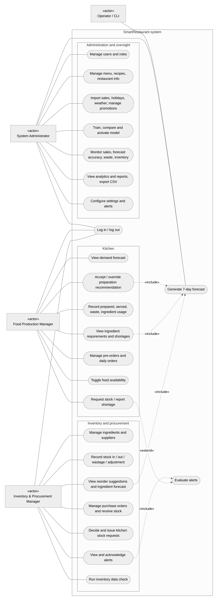

*Figure 1. Use case diagram. Actors are drawn as boxes labelled «actor»; «include» marks use cases that always rely
on the forecast or on alert evaluation.*

## 5.2 Functional requirements

| ID | Requirement (from the proposal) |
|---|---|
| FR1 | Authorised login with role-based access for the three roles |
| FR2 | Import or enter historical sales data per menu item |
| FR3 | Record or import contextual data (day of week, holidays, promotions, weather) |
| FR4 | Generate item-level demand forecasts for a defined short-term period |
| FR5 | Convert forecasts into recommended preparation quantities |
| FR6 | Estimate ingredient requirements from forecasts and recipe data |
| FR7 | Compare forecast requirements to current stock and flag shortages |
| FR8 | Record actual sales, preparation quantities and waste |
| FR9 | Record stock movements: stock-in, stock-out, adjustments and wastage |
| FR10 | Display forecasts, recommendations and alerts on a dashboard |
| FR11 | Store forecasts and outcomes for future evaluation |
| FR12 | View basic operational reports, including waste and inventory trends |

The proposal's function tables list 47 role functions (14 administrator, 15 kitchen, 18 inventory). They were turned
into 56 user stories with acceptance criteria (`docs/REQUIREMENTS.md`); Appendix A maps every function to its
implementation.

## 5.3 Non-functional requirements

| ID | Requirement | Measurable target used in this project |
|---|---|---|
| NFR1 | Usability: simple enough for non-technical staff | A first-time user completes the daily kitchen task in about five minutes; pages usable at phone width |
| NFR2 | Performance: forecasts within a few seconds | Forecast run for all items under 5 s; any page or API request under 3 s |
| NFR3 | Reliability: handles missing or incomplete data | Missing history falls back to a labelled baseline; failed runs are recorded with a readable reason |
| NFR4 | Accessibility: standard browsers, desktop and mobile | No horizontal scrolling at 360, 768 and 1280 px |
| NFR5 | Security: authentication and RBAC | Server-side role check on every route, CSRF on all writes, hashed passwords, lockout |
| NFR6 | Maintainability: periodic model updates | Versioned models with activation and rollback; layered code with enforced import rules |
| NFR7 | Scalability: future multiple outlets | Every table carries `outlet_id` |
| NFR8 | Data integrity: input validation | Validation in the service layer, database constraints as the backstop |

## 5.4 Scope and exclusions

In scope: one restaurant (outlet); seven-day item-level forecasts; preparation, ingredient, alert and reorder
decisions; recording of outcomes; internal supplier and purchase-order records; dashboards and reports.

Out of scope, as approved in the proposal: multiple branches, automatic ordering or any integration with supplier
systems, point-of-sale and payments, staff scheduling, accounting, and continuous automatic retraining (models are
retrained periodically by the administrator).

## 5.5 Key assumptions

| Assumption | Reason |
|---|---|
| **Synthetic data** | No real restaurant sales history could be obtained in the project period. A generator produces two years of realistic data with known effects (Section 6.3); it is labelled "Synthetic demo data" on every page. |
| Location Colombo | Holidays and weather follow Colombo. |
| Forecast horizon 7 days | Covers next-day preparation and supplier lead times of a few days. |
| One builder for the software | **[TEAM: describe the actual division of work, as required by the module.]** |

# 6. Methodology

## 6.1 Development approach

The project followed an **Agile** life cycle, as proposed. Work was planned as vertical slices, each ending with
something that ran end to end: foundation (models, login, role checks), data and forecasting, preparation
recommendation and kitchen recording, stock, requirements and alerts, the inventory interface, and administration and
monitoring (`docs/PLAN.md`). Requirements were prioritised into tiers: **M1** (the core demo loop, never cut), **M2**
(the rest of the minimum viable product), **S** (stretch) and **X** (postponed), with a pre-agreed "trim ladder" of
features to drop if the schedule slipped. After the core was finished, a scope change on 21 September 2026 brought
every remaining function of the proposal into scope; these were built in three further tiers. Each feature followed
the same order: service and its tests, then the API, then the page.

**Object-Oriented Analysis and Design** was used for the analysis and design, documented with UML use case, class,
sequence and activity diagrams (Figures 1 and 3 to 10) and an entity-relationship diagram (`docs/DATABASE.md`).

Git and GitHub were used for version control, with one commit per finished work package.
**[TEAM: describe meetings, task allocation, the board or tracker used, and how the team reviewed work.]**

## 6.2 Technology choices

| Layer | Technology | Why |
|---|---|---|
| Back end | Python 3.14, Flask 3.1, Flask-SQLAlchemy, Flask-Migrate, Flask-Login, Flask-WTF | Proposal stack; small, well-documented, suits a layered design |
| Database | MariaDB 11.8 (MySQL compatible) | The proposal specifies MySQL; MariaDB is a drop-in replacement and was available on the server |
| Data and ML | pandas, NumPy, scikit-learn 1.9 (Random Forest), XGBoost 3.4, joblib | Proposal stack; tree models suit tabular data with interacting features |
| Front end | Jinja2 pages with Vue 3, Bootstrap 5 and Chart.js, stored locally (no build step, no CDN) | Responsive interface without a separate single-page application; works offline at the demo |
| Testing | pytest, pytest-cov, Playwright (headless Chromium) | Unit, integration, API, timing and browser tests |
| Deployment | gunicorn on an Ubuntu server, MariaDB instance for the project | Simple demo deployment; a local copy is the fallback |

## 6.3 Data strategy

No real sales history from a Sri Lankan restaurant could be obtained during the project. Rather than build on a small
or unrelated public dataset, the team generated **synthetic data** whose structure is known, which also makes it
possible to check whether the model recovers that structure. The generator (`app/seed/generate.py`) produces daily
sales for ten menu items from 1 September 2024 to the day before the demo (763 days, 7,630 item-days), together with
preparation and waste records. Expected demand for an item on a day is

> expected = base(item) × weekday × month × holiday × promotion × rain × trend

where Friday to Sunday are 15-30% above Monday to Thursday; April and December are 15% higher; public holidays add
15%; Poya days reduce meat dishes by 35% and raise other food by 10%; school holidays lift some items by 10%; a
promotion with discount *d*% raises demand by 2*d*%; rain lowers demand by up to 16% (32% for drinks); and a 10% upward
trend runs over the two years. Actual sales are drawn as Poisson(expected × noise) with log-normal noise. Because the
expected value is known, the **noise floor** (the error of a perfect model) can be computed and reported.

The holiday calendar (`data/holidays_lk.csv`) lists Poya days, public holidays and approximate school vacations.
The Poya days and movable holidays are the dates declared in the government calendars (checked on 4 October 2026; an
earlier version computed Poya days from the astronomical full moon and put 19 of them a day late). The data are
loaded through the same import services as real data would be, so real sales can replace them through the CSV import
without code changes.

## 6.4 Evaluation design

Forecast accuracy is measured with MAE (in portions, the main criterion), RMSE, MAPE, WAPE, R² and bias. Evaluation is
always **chronological**: a model is tested only on days after the data it was trained on, and the weather used for
test days is the seasonal estimate that would be known when forecasting, not the weather that actually happened.
Three levels of evidence are used:

1. **Hold-out:** the last 56 days, used to select the model shipped in the system.
2. **Rolling-origin cross-validation:** six consecutive 28-day windows, each with the models retrained on all earlier
   days, to check that the comparison does not depend on one period (Hyndman and Athanasopoulos, 2021).
3. **Feature ablation:** the selected algorithm trained with calendar and history features, then with holidays,
   promotions and weather added one group at a time, with errors broken down on holiday, promotion and wet days.

The decision layer and the rest of the system were evaluated with hand-calculated test cases, automated tests,
scripted browser walkthroughs and a security checklist (Chapter 10).

# 7. System design

## 7.1 Architecture

SmartRestaurant is a layered **Model-View-Controller** web application (Figure 2, from `docs/ARCHITECTURE.md`).

- **View:** Jinja2 page templates per role; each page mounts a small Vue component that calls the JSON API and draws
  charts with Chart.js.
- **Controller:** Flask blueprints for the pages (`auth`, `admin`, `kitchen`, `inventory`) and for the API
  (`/api/v1`). Controllers only parse the request, check the role, call one service method and map errors to HTTP
  status codes (422 validation, 404 not found, 409 conflict).
- **Model:** a **service layer** that holds all business logic, validation and transactions; the **`ml` package**
  (pure Python on DataFrames, no database or web code); and SQLAlchemy models that only describe tables.

These rules are enforced by an automated architecture test: controllers may not import models or the `ml` package or
commit transactions, services may not know about HTTP, the `ml` package may not import Flask or the database, and
only the forecasting service may call it. A command-line interface (`flask smartrest ...`) gives administrators and
operators access to seeding, training, forecasting, evaluation and checks through the same services.

```
Browser (Vue page) --fetch JSON--> API controller --> role check, CSRF --> service --> SQLAlchemy --> MariaDB
                                                                              \--> ml package --> model files
```

*Figure 2. Layers and request path (the full diagram is in `docs/ARCHITECTURE.md`, section 2).*

## 7.2 Service layer

Eight services each own one area (Figure 3). The arrows show which services call which; the graph has no cycles, and
an automated test fails if a service imports one it is not allowed to.

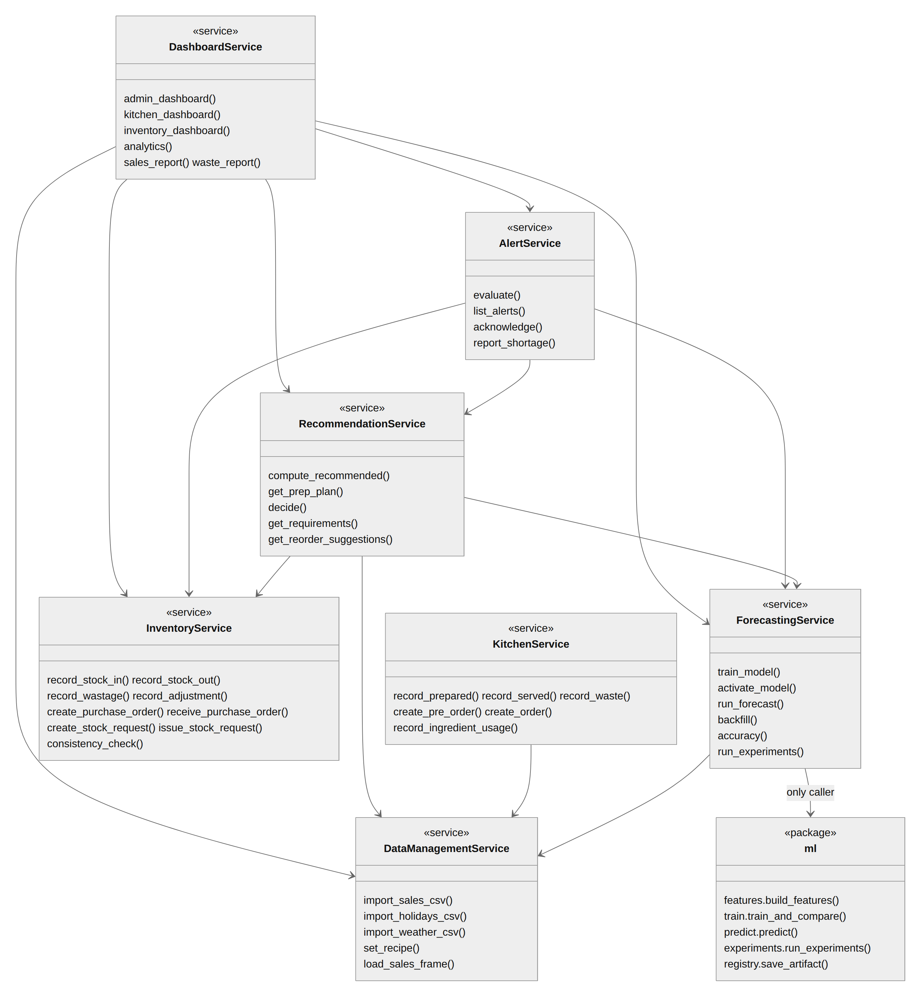

*Figure 3. Service layer and `ml` package with their main operations; arrows are the actual imports.
`AuthService` and the settings and audit helpers call no other service and are omitted.*

## 7.3 Data model

The database has 30 tables. Figures 4 and 5 show the main classes; the full entity-relationship diagram is in
`docs/DATABASE.md`. Design decisions worth noting:

- **Stock is never stored as a running total.** Each delivery is a *batch* with an expiry date, and every change is an
  immutable *movement* (stock-in, stock-out, wastage, adjustment). Current stock is derived from batches and checked
  against the movements by the inventory data check.
- **Forecasts are never overwritten.** A new run inserts new rows and marks the old ones as no longer latest, so every
  forecast that was ever shown can be compared with what actually happened (FR11).
- **Recommendations store the numbers behind them** (forecast, buffer, pre-orders, batch size, recommended and final
  quantity, override reason), so every kitchen decision can be audited.
- Money and quantities are exact decimals; every table carries `outlet_id` for a future multi-outlet version (NFR7).

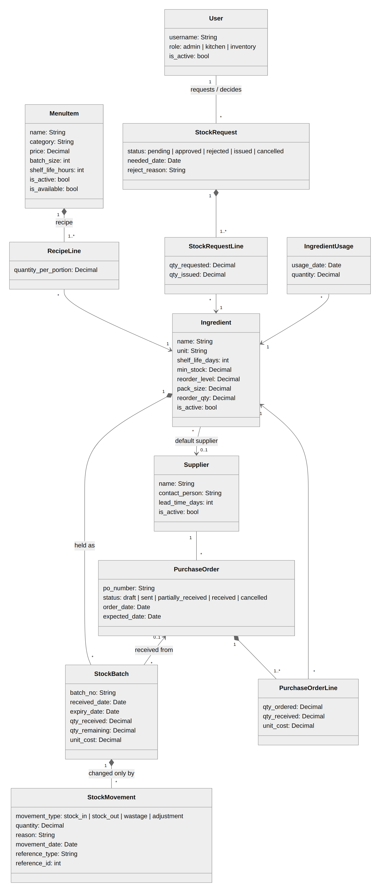

*Figure 4. Menu, recipes, stock and procurement.*

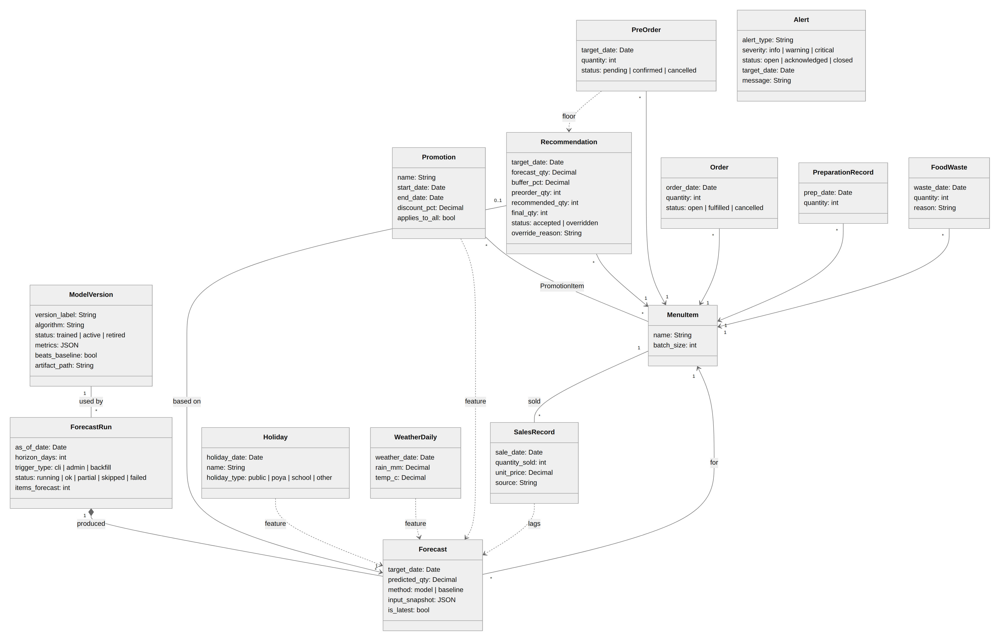

*Figure 5. Demand data, forecasting and kitchen decisions. Dashed arrows show which data feed the forecast.*

## 7.4 Key interactions

Figures 6 to 8 show the three most important flows: producing the forecast, a kitchen decision on it, and receiving
stock that clears an alert.

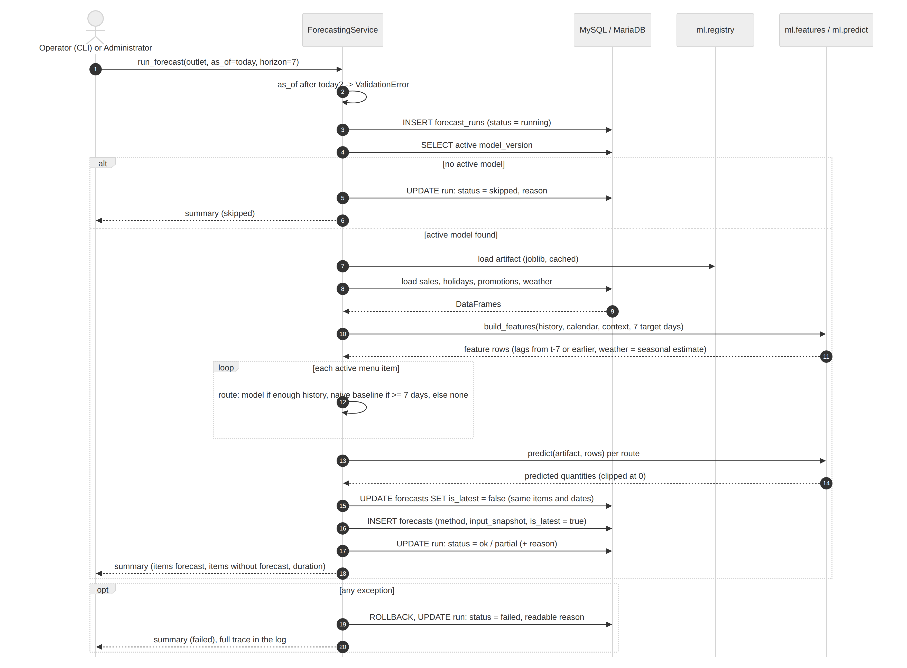

*Figure 6. Generating the seven-day forecast, including the skipped (no active model) and failed paths.*

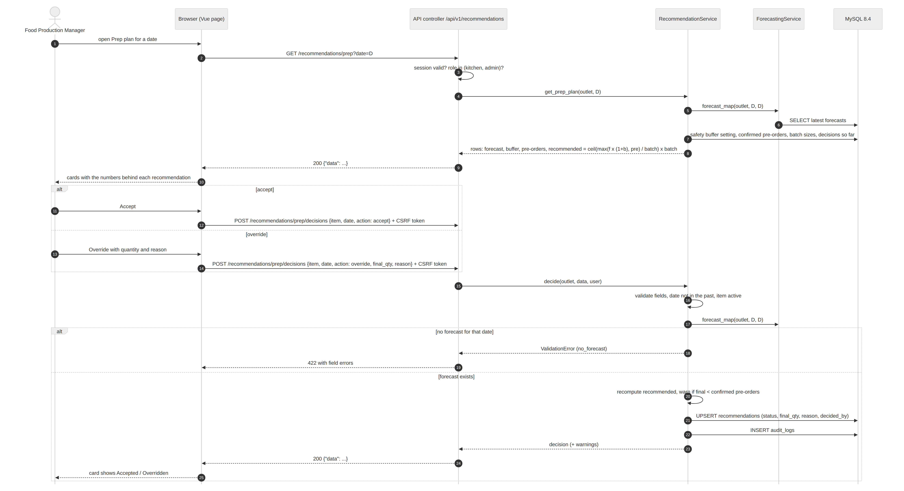

*Figure 7. The kitchen opens the prep plan and accepts or overrides a recommendation.*

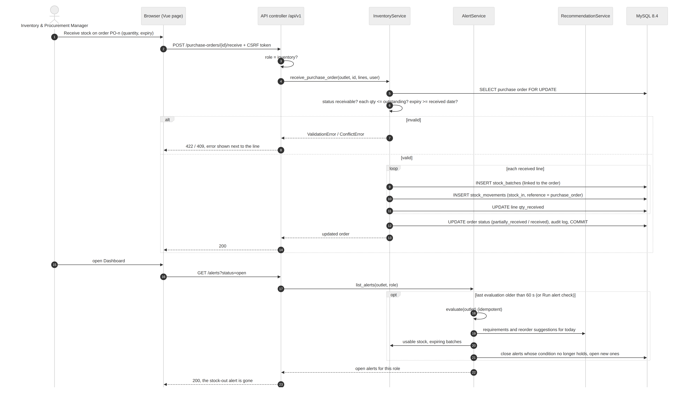

*Figure 8. Receiving a purchase order; the stock-out alert closes on the next alert evaluation.*

## 7.5 Decision workflows

Figure 9 shows the daily cycle that links the forecast to purchasing; Figure 10 the kitchen stock request.

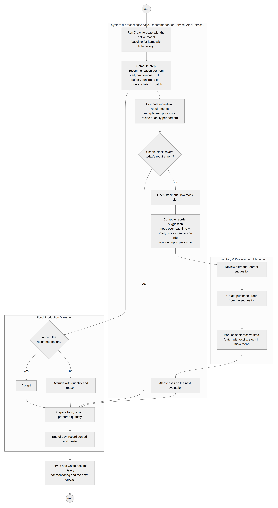

*Figure 9. The daily forecast-to-purchase cycle across the system and the two manager roles.*

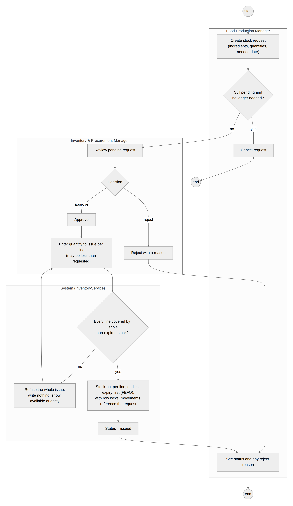

*Figure 10. A kitchen stock request: issuing is all-or-nothing across lines and never uses expired stock.*

## 7.6 Interface design

The interface follows one layout for all roles: a sidebar with the role's pages, a top bar with the "Synthetic demo
data" label and the alert bell, and pages built from shared components (stat tiles, tables, cards, charts). Each role
has an accent colour. Kitchen pages are designed for phone use in the kitchen (large buttons, one card per item), and
every number in a recommendation is shown next to it so staff can see why the system suggests it. The page designs
and components are specified in `docs/UI_PLAN.md`.

## 7.7 Security design

Passwords are stored as salted scrypt hashes; logins are locked after repeated failures and give the same message for
an unknown user, a wrong password and a deactivated account. Every page and API route declares the roles allowed, and
the server checks them on every request. All writes require a CSRF token; output is escaped (no raw HTML is inserted
from data); queries are parameterised by SQLAlchemy. Sessions expire after 30 minutes of inactivity, cookies are
HttpOnly and SameSite, and logged-in pages are not cached. Secrets live in an environment file that is not in the
repository.

# 8. Machine-learning approach

## 8.1 Problem formulation

The target is the **quantity sold per menu item per day**. Each morning the system forecasts the next seven days for
every active item. Forecasting is direct, not recursive: every history feature is lagged by at least seven days, so
the forecast for day *t* uses only sales up to *t*-7, and the same model serves all seven days without feeding its
own predictions back in. This also prevents leakage by construction.

## 8.2 Features

| Group | Features |
|---|---|
| Calendar | day of week, weekend flag, month |
| Holidays | public holiday, Poya day, school holiday (flags) |
| Promotion | discount percentage on that item and day |
| Weather | rain (mm) and temperature (°C); when forecasting, the average for that month from past data |
| History | sales 7, 14, 21 and 28 days earlier; mean of the 7 and 28 days ending 7 days earlier |
| Item | one-hot indicator of the menu item |

Missing history is handled explicitly (NFR3): a missing lag is filled from the next weekly lag, then from the rolling
means, then from the item's own average, and the forecast is flagged as "lags imputed". An item with less than 35 days
of history (a setting) uses the naive baseline instead of the model; an item with less than a week gets no forecast,
and the run reports it as partial with the reason.

## 8.3 Models

| Model | Description |
|---|---|
| naive_lag7 | Same weekday last week (baseline) |
| seasonal_mean4 | Mean of the last four same weekdays (baseline) |
| Random Forest | 300 trees, minimum 3 samples per leaf (Breiman, 2001; scikit-learn) |
| XGBoost | 300 boosted trees, depth 5, learning rate 0.05, 80% row and column sampling (Chen and Guestrin, 2016) |

Hyperparameters were set to reasonable values and not tuned, to keep the comparison simple and avoid overfitting the
single hold-out; a search is left as future work.

## 8.4 Training, selection and versioning

Training uses all usable history except the last 56 days. The model with the **lowest hold-out MAE** is selected (ties
go to the simpler model), then refitted on all history for use. A model is shipped only with its comparison: the
stored metrics, whether it beats the naive baseline, and a sentence explaining the choice. If no learned model beats
the baseline, the baseline is used and the system says so. Each trained model is a **version** with its metrics,
features, parameters, library versions and file; the administrator activates a version from the Models page, and the
previous one is kept for rollback (NFR6). Forecasts for past days (the backfill used for accuracy monitoring) use the
copy of the model fitted before the hold-out, so monitored accuracy is genuinely out-of-sample.

## 8.5 Evaluation tool

`flask smartrest evaluate` runs the cross-validation and the feature ablation of Section 6.4 on the current data
without storing or activating anything (`app/ml/experiments.py`). Its full-feature hold-out result reproduces the
shipped model's metrics exactly, which an automated test checks.

## 8.6 Decision layer

The forecast is converted into decisions by explicit, tested formulas:

- **Preparation quantity:** recommended = ⌈ max(forecast × (1 + buffer), confirmed pre-orders) ÷ batch size ⌉ ×
  batch size, with a 10% safety buffer by default. Example: forecast 101.7 chicken burgers, buffer 10%, batch 6 gives
  ⌈111.9 ÷ 6⌉ × 6 = **114**. The kitchen accepts it or overrides it with a quantity and a mandatory reason.
- **Ingredient requirements:** the sum over menu items of planned portions × recipe quantity per portion, compared with
  usable (unexpired) stock; a gap is a shortage and raises an alert.
- **Reorder suggestion:** need over the supplier lead time + minimum stock − usable stock − quantity already on order,
  rounded up to the pack size and the minimum order quantity; never negative.
- **Alerts:** low stock, critically low stock, projected stock-out, expiry warning, waste risk, failed forecast and
  manually reported shortage. Alerts are re-evaluated when read (at most once a minute) and close themselves when the
  condition no longer holds.

# 9. Implementation

## 9.1 Code base

| Part | Contents | Lines of code |
|---|---|---|
| `app/models` | 30 tables | 513 |
| `app/services` | 8 services plus settings, audit and validation helpers | 2,819 |
| `app/controllers` | page and API blueprints (23 pages, 89 API endpoints) | 651 |
| `app/ml` | features, training, prediction, experiments, model registry | 455 |
| `app/seed` | catalogue and synthetic data generator | 241 |
| `app/static/js` | Vue page components and shared code (libraries excluded) | 1,217 |
| `app/templates` | 28 Jinja2 templates | |
| `tests` | unit, integration, API, timing and browser tests | 2,967 |

Lines of code exclude blank lines and comments. Database changes are versioned with Alembic migrations.

## 9.2 Main features as built

**Kitchen.** The dashboard shows the day's plan, alerts and a demand chart. The forecast page shows seven days per item.
The prep plan (Figure 11) shows one card per item with the forecast, buffer, confirmed pre-orders, batch size and
recommendation; the manager accepts, overrides with a reason, marks an item unavailable and records prepared
quantities. The ingredients page shows requirements against usable stock, with buttons to request stock or report a
shortage (Figure 12). End-of-day pages record served quantities, waste with a reason, and ingredient usage (expected
usage is shown; recording never changes stock). Pre-orders (confirmed ones raise the preparation quantity) and daily
orders share one page; stock requests have their own.

**Inventory.** The dashboard shows stock status, alerts, reorder suggestions and pending kitchen requests (Figure 13).
Pages cover ingredients and stock with batches and expiry, stock movements (stock-in, stock-out with earliest-expiry
first, wastage, adjustment to a counted quantity), the ingredient demand forecast, reorder suggestions with every
term shown (Figure 14), purchase orders created directly from suggestions and received in full or in part, suppliers,
kitchen requests (approve, reject with a reason, issue) and the inventory data check.

**Administration.** The dashboard summarises sales, forecasts, waste, stock and alerts. Further pages manage users
and roles, the menu and recipes, restaurant information, settings and alert types, and data import (sales, holidays,
weather CSV with a dry run and row-level errors) and promotions. The Models page (Figure 15) trains, compares,
activates and runs forecasts; Monitoring shows sales, forecast accuracy per item, waste and inventory with CSV
export; Analytics shows weekday patterns, holiday and promotion effects, error and waste trends.

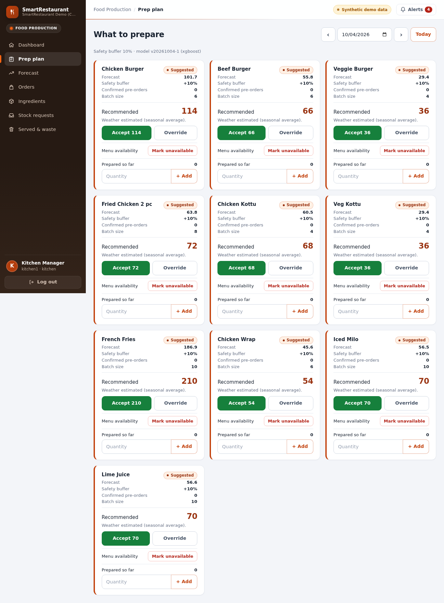

*Figure 11. Kitchen prep plan: each recommendation shows the numbers behind it.*

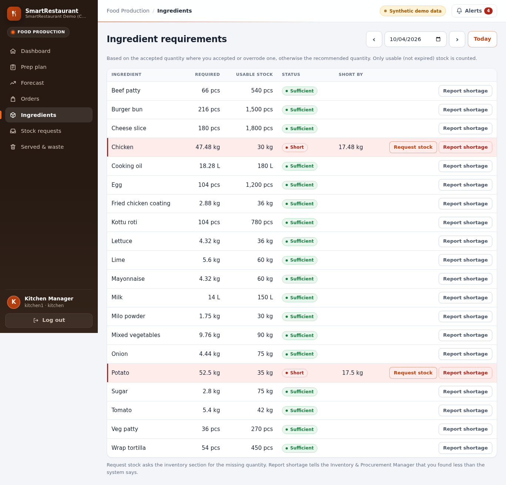

*Figure 12. Ingredient requirements against usable stock, with shortages highlighted.*

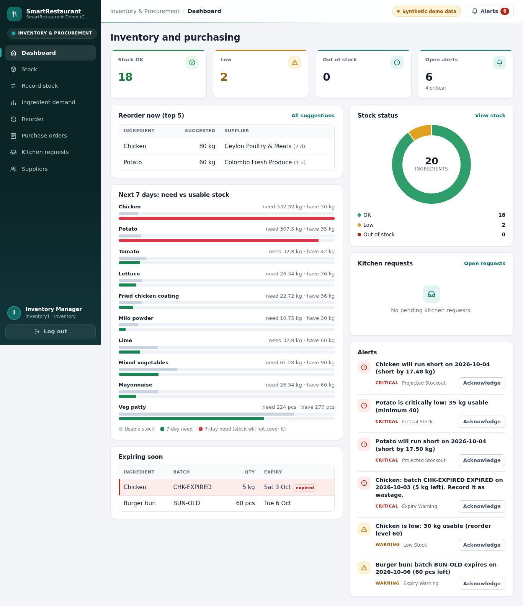

*Figure 13. Inventory dashboard with alerts, reorder suggestions and kitchen requests.*

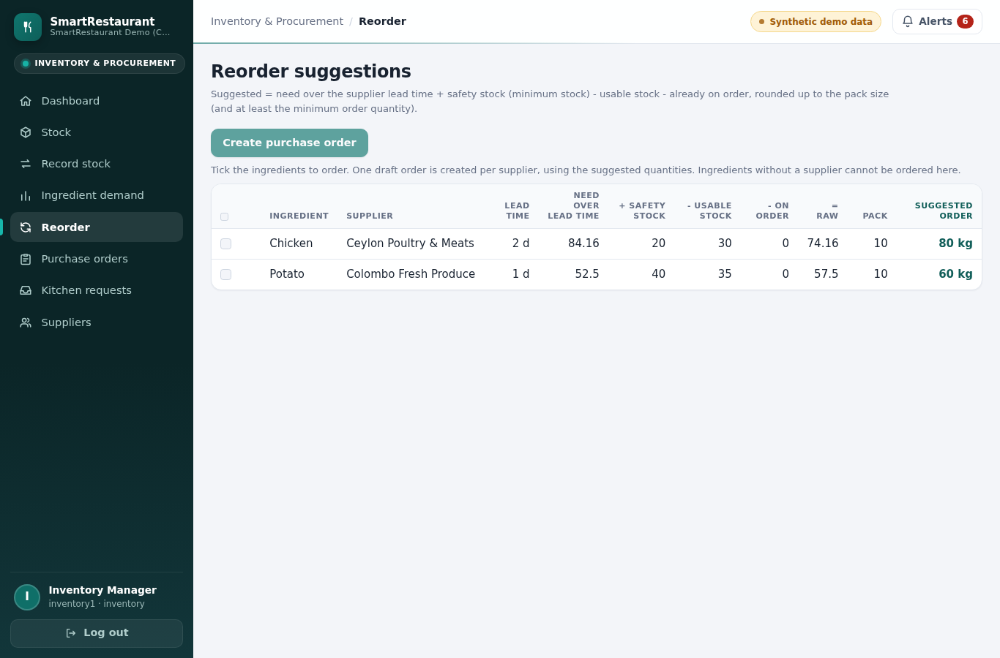

*Figure 14. Reorder suggestions with every term of the calculation.*

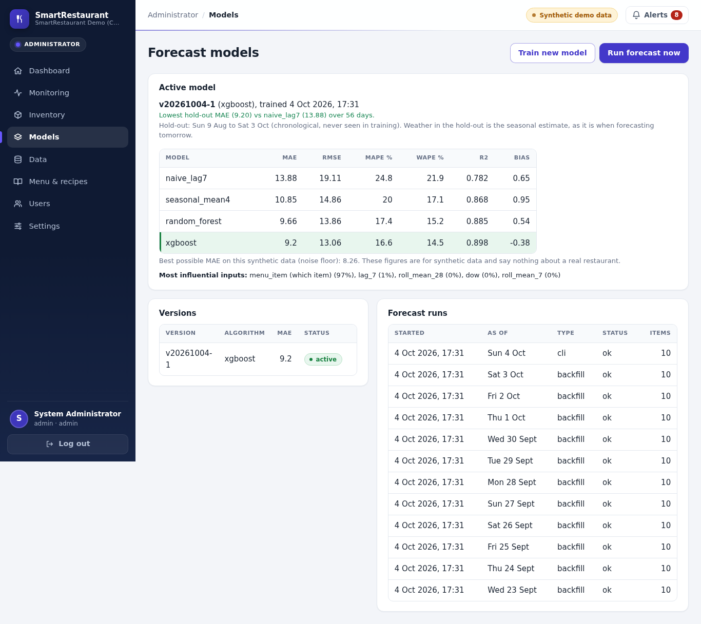

*Figure 15. Administrator's Models page: active model, comparison with the baselines, versions and forecast runs.*

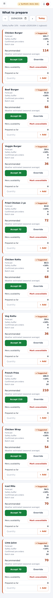

*Figure 16. The prep plan at phone width (390 px).*

## 9.3 Deployment

The demonstration runs on an Ubuntu server under gunicorn, with the project's own MariaDB instance. One command
(`flask smartrest demo-reset`) rebuilds the demo state in about 20 seconds: seed data, synthetic history, training and
activation, a 56-day backfill, today's forecast and alerts. There is deliberately no background scheduler; forecasts
are run from the Models page or the command line, which matches the proposal's periodic (not automatic) model updates.
A local copy and a database dump are kept as the fallback for the demonstration.
**[TEAM: state the demo URL or local setup used at the presentation.]**

# 10. Testing

## 10.1 Strategy

Testing followed the plan in `docs/TESTING.md`; results are recorded in `docs/TEST_LOG.md`. Test levels:

| Level | What it checks | Tool |
|---|---|---|
| Unit | Formulas (preparation quantity), features (lags, no leakage, missing data), metrics, training, experiments | pytest, in-memory SQLite |
| Integration | Each service with a database: kitchen recording, requirements, reorder, alerts, stock and earliest-expiry logic, imports, forecast runs, purchase orders, stock requests, reports | pytest, SQLite and MariaDB |
| API and security | Every route for every role, login and lockout, CSRF, validation, escaping, response format | pytest with the Flask test client |
| Database | Constraints, concurrency (two simultaneous stock-outs), migrations match the models | pytest on MariaDB |
| Performance | Forecast run time and page and API response times on the full demo data | pytest |
| Browser (scripted UAT) | Each role's daily tasks in headless Chromium at phone and desktop widths; no console errors | Playwright |
| Architecture | Import rules between layers and the service dependency graph | pytest |

**Expected values were calculated by hand** before the code was run (`docs/TESTING.md` section 4) and never copied
from the program's output. Examples: 54 burgers with a 10% buffer and batches of 6 give 60; the chicken requirement
for the test plan is 15.48 kg with 3.48 kg short; a reorder case gives 25 kg (15 kg when 10 kg are already on order);
stock-out of 5 kg takes 4 kg from the earliest-expiring batch and 1 kg from the next.

## 10.2 Results

| Measure | Result |
|---|---|
| Automated tests | **250** in total: 238 fast tests (all passing on 4 October 2026) and 12 MariaDB and timing tests (all passing at their last run, 21 September 2026; their code has not changed since) |
| Coverage of services and ML | 91% (target 80%) at the last measured run |
| Route-by-role matrix | Every route checked for anonymous, administrator, kitchen and inventory users; a route without a declared rule fails the test |
| Browser walkthroughs | Kitchen (390 px), inventory (1280 px) and administrator scripts pass; all pages without horizontal scrolling at 360, 768 and 1280 px; no JavaScript errors |
| Concurrency | Two parallel stock-outs of 8 kg against 10 kg: exactly one succeeds and stock never goes negative; the same for purchase-order receipts and stock-request issues |
| Forecast run, 10 items × 7 days (NFR2) | **0.27 s** (target under 5 s) |
| Slowest page or API request (NFR2) | **0.23 s** (target under 3 s) |
| Model training | about 11 s on a 2-core server |

The security checklist (password hashing, server-side role checks, CSRF, escaping, parameterised queries, lockout with
a generic message, session settings, no secrets in Git) passed in full (`docs/TEST_LOG.md` section 4).

## 10.3 Defects found by testing

| Defect | Fix |
|---|---|
| `trigger` is a reserved word in MySQL/MariaDB, so the first migration failed | Column renamed `trigger_type` |
| Under MariaDB 11, a locking read after a snapshot read can fail (error 1020) when two stock-outs run at once | Stock-out, wastage and alert evaluation retry on a fresh snapshot |
| Backfilled forecasts used the model refitted on all history, so monitored accuracy looked better than it was (MAE 7.9 instead of 9.4) | Backfill uses the model fitted before the hold-out |
| Feature importance showed one menu-item column at 91% | Item indicators reported together as "which menu item" |
| A shared chart component hid every other bar label; a page overflowed a 360 px screen by 5 px | Both fixed and covered by the browser test |
| Pre-order validation reported some errors only after others were fixed | All rules checked in one pass |
| Poya dates in the holiday file were computed and 19 were one day late | Replaced by the declared dates; data and model rebuilt |

## 10.4 What was not tested

There was no test with real restaurant staff and no usability score (SUS), so the five-minute target of NFR1 was not
measured; the browser walkthroughs were run by the developer. Only Chromium was tested (the proposal lists Chrome,
Firefox and Edge). There was no accessibility audit, load test or penetration test.
**[TEAM: if a usability session is run before submission, add its results here.]**

# 11. Results and evaluation

All results in this chapter are on **synthetic data** (Section 6.3). They show that the pipeline works and which
contextual factors the model can use when such effects exist; they are not evidence of accuracy in a real restaurant.
Full tables are in `docs/ML_EVALUATION.md`.

## 11.1 Model comparison on the hold-out

Hold-out: 9 August to 3 October 2026 (56 days, 560 item-days); training: 6,790 item-days.

| Model | MAE | RMSE | MAPE % | WAPE % | R² | Bias |
|---|---|---|---|---|---|---|
| naive_lag7 (baseline) | 13.88 | 19.11 | 24.8 | 21.9 | 0.782 | 0.65 |
| seasonal_mean4 | 10.85 | 14.86 | 20.0 | 17.1 | 0.868 | 0.95 |
| Random Forest | 9.66 | 13.86 | 17.4 | 15.2 | 0.885 | 0.54 |
| **XGBoost (selected)** | **9.20** | **13.06** | **16.6** | **14.5** | **0.898** | -0.38 |

XGBoost reduced the error of the naive baseline by **33.7%** and beat it for every one of the ten items (Appendix C).
The noise floor of the data is an MAE of 8.26, so the selected model is within 0.93 portions of the best possible.
Bias is close to zero, so the forecast does not systematically over- or under-prepare. The overall WAPE of 14.5% meets
the planned target of about 15%. The accuracy monitoring page, which compares stored forecasts with actual sales for
the 56 backfilled days, agrees with these figures.

## 11.2 Cross-validation

Six consecutive 28-day windows from 19 April to 3 October 2026, each with models retrained on all earlier days:

| Model | MAE mean | MAE std | WAPE % mean | Windows beating naive | Windows won |
|---|---|---|---|---|---|
| naive_lag7 | 13.86 | 1.53 | 22.0 | - | 0 |
| seasonal_mean4 | 11.04 | 1.38 | 17.5 | 6 of 6 | 0 |
| Random Forest | 9.63 | 0.77 | 15.3 | 6 of 6 | 3 |
| XGBoost | 9.45 | 0.83 | 15.0 | 6 of 6 | 3 |

Both learned models beat both baselines in every window, by 3.2 to 5.7 portions. Random Forest and XGBoost each won
three windows and their difference (0.18) is much smaller than the variation between windows (about 0.8), so **they
should be regarded as equivalent**: XGBoost was selected on the hold-out, but the evidence does not show it is the
better algorithm. The hardest window (late April to mid May, covering New Year, Vesak and Adhi Poson) left XGBoost 2.2
portions above the noise floor, against 0.7 to 1.1 in the others.

## 11.3 Contextual factors (ablation)

| Feature set | CV MAE (mean ± std) | Windows improved | Hold-out MAE |
|---|---|---|---|
| calendar + history | 10.24 ± 0.97 | - | 9.96 |
| + holidays | 9.99 ± 1.13 | 4 of 6 | 9.69 |
| + promotions | **9.36 ± 0.79** | **6 of 6** | **9.12** |
| + weather (shipped model) | 9.45 ± 0.83 | 3 of 6 | 9.20 |

| Error (MAE) on ... | calendar + history | + holidays | + promotions | + weather |
|---|---|---|---|---|
| holiday days (370 item-days) | 11.29 | 10.74 | 10.19 | 10.51 |
| promotion item-days (46) | 32.03 | 35.19 | **18.36** | 18.52 |
| wet days, ≥ 5 mm (670) | 10.24 | 10.24 | 9.49 | 9.49 |

**Promotions** matter most: adding the discount improved every window and almost halved the error on promotion days.
**Holidays** help modestly and mainly on holiday days. **Weather** adds nothing at forecast time, because the model
only knows the monthly average, not tomorrow's rain, so it cannot tell a wet day from a dry one. Feature importance
would have hidden these results: "which menu item" takes 97% of the importance and every contextual feature is under
1%, yet removing promotions clearly changes the forecasts.

## 11.4 Requirements

| Requirement | Status | Evidence |
|---|---|---|
| FR1 login and roles | Met | Route-by-role test; lockout, timeout |
| FR2 sales history | Met | CSV import with dry run and row errors; generator uses the same import |
| FR3 contextual data | Met | Holiday and weather import; promotions page |
| FR4 item-level forecasts | Met | Seven-day forecasts for all items; Figures 6, 15 |
| FR5 preparation quantities | Met | Prep plan with accept and override; hand-calculated tests |
| FR6 ingredient requirements | Met | Requirements page and ingredient forecast |
| FR7 shortages flagged | Met | Shortage rows and projected stock-out alerts |
| FR8 actual sales, preparation, waste | Met | Served, prepared and waste recording |
| FR9 stock movements | Met | Stock-in, stock-out, wastage, adjustment as immutable movements |
| FR10 dashboards | Met | Dashboard per role with forecasts, recommendations and alerts |
| FR11 forecasts and outcomes stored | Met | Forecast history kept; accuracy monitoring |
| FR12 reports | Met | Sales, waste, forecast accuracy, inventory trend and movements, with CSV |
| NFR1 usability | Partly | Designed for phone use and shows reasons; not measured with real users |
| NFR2 performance | Met | 0.27 s forecast; 0.23 s slowest request |
| NFR3 missing data | Met | Imputed lags, baseline fallback, partial and failed runs with reasons |
| NFR4 browsers and mobile | Partly | 360 to 1280 px verified in Chromium; Firefox and Edge not tested |
| NFR5 security | Met | Security checklist passed |
| NFR6 maintainability | Met | Model versions with rollback; enforced layers; 250 tests |
| NFR7 scalability | Met (design) | `outlet_id` on every table; one outlet implemented, as scoped |
| NFR8 data integrity | Met | Service validation, database constraints, stock data check |

Of the 47 functions in the proposal, 45 are fully implemented and 2 partly: food preparation management is covered by
the accept or override decision and prepared-quantity recording without a separate status workflow, and expiry
tracking by batches with expiry dates and expiry alerts without a dedicated page (Appendix A).

## 11.5 Objectives and research questions

| | Outcome |
|---|---|
| O1, RQ1 | Achieved on synthetic data: both learned models beat the simple rules in every test window, by about a third on the hold-out |
| O2 | Achieved: selection on a chronological hold-out, confirmed by cross-validation; the shipped model is versioned with its evidence |
| RQ2 | Answered on synthetic data: promotions help most, holidays modestly, weather not without a weather forecast |
| O3, RQ3 | Achieved: explicit, tested formulas turn the forecast into preparation, ingredient, alert and reorder decisions, shown with their inputs and with a human accept or override step |
| O4 | Achieved: outcomes recorded and compared with forecasts in monitoring |
| O5 | Achieved: role-based, responsive interface; security checklist passed |
| O6 | Achieved, except the usability study with real users (Section 10.4) |

# 12. Discussion

**Forecasting.** On data with the kind of structure expected in a Sri Lankan fast-food outlet, tree-based models
captured weekday, holiday and promotion effects and cut the error of a same-day-last-week rule by about a third. The
cross-validation is the more important result: it shows the advantage holds across six different periods rather than
one convenient hold-out. It also shows that the choice between Random Forest and XGBoost matters little here; what
matters is using a learned model with the right context instead of a fixed rule.

**Context.** The ablation answers the proposal's question about contextual factors more precisely than feature
importance could. Promotions are the most valuable input, which makes sense because they are planned in advance and
known exactly. Holidays help on the days they occur. Weather is the instructive negative result: a feature that
clearly affects demand in the data is useless if its value is not known at forecast time. For a restaurant this means
that recording promotions and holidays accurately is worth more than recording past weather, and that weather would
need a real forecast to help.

**From forecast to decision.** The decision layer is deliberately simple and transparent. Each recommendation shows the
forecast, buffer, pre-orders and batch size it came from, the kitchen can override it with a reason, and every
decision is stored with its inputs. This design responds to the gap in the literature: commercial systems use fixed
rules, research stops at accuracy, and SmartRestaurant connects the two while keeping a person in charge of the final
quantity. The fixed 10% buffer is a pragmatic choice; a buffer derived from forecast uncertainty would trade waste
against stock-outs more precisely.

**Synthetic data.** Using generated data was a necessity, and it has a hidden benefit: because the true demand is
known, the noise floor shows how close the model is to the best possible, which real data cannot show. The cost is
that the effects were written by the team, so their size says nothing about a real restaurant. The holiday calendar
correction (Section 10.3) also shows why data quality matters: a one-day error in 19 Poya dates would have taught the
model the wrong days.

**Comparison with the literature.** Like Arunraj and Ahrens (2015), the results show that calendar and promotion
effects matter for perishable demand; like the preprint of Naeem et al. (2026), Random Forest performs well, though
here it is not distinguishable from XGBoost. Unlike both, the project evaluates the forecast inside a decision process.
**[TEAM: extend once more sources are added to Chapter 4.]**

# 13. Limitations

1. **Synthetic data.** Accuracy, and the size of each contextual effect, are not evidence about a real restaurant.
2. **Sales are not limited by stock-outs** in the generator; in reality sales understate demand on days an item sells out.
3. **No usability study** with restaurant staff; NFR1 is not measured.
4. **No prediction intervals:** the safety buffer is a fixed percentage.
5. **Weather** is only a seasonal estimate at forecast time; no weather service is used.
6. **No hyperparameter search** and one model for all items.
7. **School vacation dates are approximate**; other holidays follow the declared calendar.
8. **Single outlet**, no supplier integration and no automatic scheduling of forecasts, as scoped.
9. **One browser** (Chromium) tested; no accessibility audit or load test.

# 14. Conclusions and recommendations

SmartRestaurant shows that a machine-learning forecast can be turned into concrete, explainable decisions for a
fast-food kitchen and its stock room: how much to prepare, what will run short, what to order and when to act. Every
function in the approved proposal is implemented, the system is secure and responsive, and its behaviour is covered by
250 automated tests and scripted walkthroughs. On synthetic data with Sri Lankan calendar effects, learned models cut
the error of a simple weekly rule by about a third in every test period, promotions and holidays were shown to improve
the forecast while weather did not, and the selected model came within one portion of the best achievable error.

The question the project cannot yet answer is how well this works in a real restaurant. The recommendations, in order
of importance:

1. **Validate on real data.** Import a real outlet's sales history through the existing CSV import and run
   `flask smartrest evaluate`; the same tables then report real accuracy and real effects.
2. **Run a usability study** with kitchen and inventory staff (task timing and SUS) and run the system alongside the
   current process for a few weeks, measuring waste and stock-outs before and after.
3. **Use a weather forecast** as input, and re-run the ablation to measure its value.
4. **Derive the safety buffer from forecast uncertainty** (prediction intervals), item by item.
5. **Account for stock-outs** when training, so sold-out days do not lower the forecast.
6. **Schedule the daily forecast** automatically and extend to several outlets (the data model already supports it).

# 15. References

**[TEAM: check every entry, complete the incomplete ones, and use the referencing style the university requires.]**

Arunraj, N.S. and Ahrens, D. (2015) 'A hybrid seasonal autoregressive integrated moving average and quantile
regression for daily food sales forecasting', *International Journal of Production Economics*, 170, pp. 321-335.

Breiman, L. (2001) 'Random forests', *Machine Learning*, 45(1), pp. 5-32.

Chen, T. and Guestrin, C. (2016) 'XGBoost: a scalable tree boosting system', in *Proceedings of the 22nd ACM SIGKDD
International Conference on Knowledge Discovery and Data Mining*. New York: ACM, pp. 785-794.

Hyndman, R.J. and Athanasopoulos, G. (2021) *Forecasting: principles and practice*. 3rd edn. Melbourne: OTexts.
Available at: https://otexts.com/fpp3/ **[TEAM: add access date]**

Naeem, et al. (2026) **[TEAM: complete: authors, title, preprint server, identifier, URL, access date; note that it is
a preprint.]**

Pedregosa, F. et al. (2011) 'Scikit-learn: machine learning in Python', *Journal of Machine Learning Research*, 12,
pp. 2825-2830.

Toast Support Center (n.d.) **[TEAM: complete: page title on inventory, URL, access date.]**

Sri Lanka holiday calendars used for `data/holidays_lk.csv`: Government Printing Department desk calendars and gazette
notices (documents.gov.lk); Central Bank of Sri Lanka, *Bank holidays 2024* and *2025* (cbsl.gov.lk); published 2025
and 2026 public holiday lists. **[TEAM: give these in the required style with access dates.]**

---

# Appendix A. Coverage of the proposal's 47 functions

| Role | Function | Implemented as |
|---|---|---|
| Admin | System Dashboard | Admin dashboard (`/admin`) |
| Admin | User Account Management | Users page: create, edit, deactivate, reset password |
| Admin | Role & Access Management | Role on the user form; server-side role checks; last admin protected |
| Admin | Menu Management | Menu & recipes page |
| Admin | Recipe/BOM Management | Recipe editor per menu item |
| Admin | Restaurant Information Management | Settings > Restaurant information |
| Admin | System Settings & Alert Configuration | Settings page: buffer, horizons, thresholds, alert types on or off |
| Admin | Sales & Revenue Monitoring | Monitoring > Sales, CSV |
| Admin | Food Demand Forecast Monitoring | Monitoring > Demand forecast and Forecast accuracy |
| Admin | Inventory Demand Forecast Monitoring | Inventory page > Ingredient demand |
| Admin | Food Waste Monitoring | Monitoring > Waste |
| Admin | Inventory Monitoring | Inventory page: stock levels, batches, movements |
| Admin | System Analytics | Analytics page |
| Admin | System Reports | Report tabs with CSV export (sales, waste, accuracy, inventory trend, movements, stock levels) |
| Kitchen | Kitchen Dashboard | Kitchen dashboard (`/kitchen`) |
| Kitchen | Daily Order Management | Orders > Daily orders |
| Kitchen | Pre-Order Management | Orders > Pre-orders; confirmed ones raise the preparation quantity |
| Kitchen | Food Demand Forecast | Forecast page |
| Kitchen | Preparation Recommendations | Prep plan: accept or override with reason |
| Kitchen | Food Preparation Management | **Partly:** decisions plus prepared recording; no separate planned/in-progress/done workflow |
| Kitchen | Preparation Quantity Recording | Prep plan "Add" prepared quantity |
| Kitchen | Ingredient Requirements | Ingredients page |
| Kitchen | Ingredient Usage Recording | Served & waste > Ingredient usage (expected vs recorded) |
| Kitchen | Actual Food Usage Recording | Served quantity recording |
| Kitchen | Sales/Served Quantity Recording | Served & waste page |
| Kitchen | Food Waste Recording | Served & waste page, with reason |
| Kitchen | Kitchen Stock Requests | Stock requests page |
| Kitchen | Food Availability Management | Mark available / unavailable on the prep plan |
| Kitchen | Shortage Reporting | Report shortage on the Ingredients page (critical alert) |
| Inventory | Inventory Dashboard | Inventory dashboard (`/inventory`) |
| Inventory | Ingredient Management | Stock page: add and edit ingredients |
| Inventory | Stock Management | Stock page and Record stock |
| Inventory | Stock-In Recording | Record stock > Stock in; purchase-order receipt |
| Inventory | Stock-Out Recording | Record stock > Stock out (earliest expiry first) |
| Inventory | Stock Level Monitoring | Stock page with status per ingredient |
| Inventory | Minimum Stock Level Management | Ingredient minimum stock |
| Inventory | Reorder Level Management | Ingredient reorder level, pack size, minimum order |
| Inventory | Ingredient Demand Forecast | Ingredient demand page |
| Inventory | Low-Stock Alerts | Low, critical and projected stock-out alerts |
| Inventory | Reorder Recommendations | Reorder page with every term |
| Inventory | Supplier Management | Suppliers page |
| Inventory | Purchase Order Management | Purchase orders: create from suggestions, send, receive in part, cancel |
| Inventory | Expiry Tracking | **Partly:** batches with expiry dates, expiry alerts, expired stock excluded from use; no dedicated expiry page |
| Inventory | Inventory Wastage Recording | Record stock > Wastage |
| Inventory | Stock Adjustment Management | Record stock > Adjustment to counted quantity, reason required |
| Inventory | Kitchen Stock Request Management | Kitchen requests: approve, reject with reason, issue |
| Inventory | Inventory Data Validation | Data check: movements against batches |

# Appendix B. Running the system

```
python -m venv .venv && . .venv/bin/activate && pip install -r requirements.txt
cp .env.example .env              # set SECRET_KEY, DATABASE_URL, SEED_PASSWORD
flask db upgrade                  # create the tables
flask smartrest demo-reset        # seed, synthetic history, train, backfill, forecast, alerts (about 20 s)
flask run                         # http://127.0.0.1:5000; log in as admin, kitchen1 or inventory1
flask smartrest evaluate          # cross-validation and ablation (read-only)
pytest -q -m "not mysql"          # fast tests
```

A 17-minute demonstration script covering every function is in `docs/DEMO_NEW_FEATURES.md`; an 8-minute version is in
`README.md`.

# Appendix C. Hold-out error per item (XGBoost vs naive baseline)

| Item | XGBoost MAE | XGBoost WAPE % | Naive MAE | Naive WAPE % |
|---|---|---|---|---|
| Chicken Burger | 11.61 | 12.3 | 22.11 | 23.5 |
| Beef Burger | 7.96 | 15.4 | 12.04 | 23.3 |
| Veggie Burger | 6.09 | 20.7 | 8.95 | 30.4 |
| Fried Chicken 2 pc | 8.87 | 13.8 | 15.88 | 24.7 |
| Chicken Kottu | 8.89 | 15.9 | 11.86 | 21.2 |
| Veg Kottu | 4.85 | 17.0 | 6.68 | 23.4 |
| French Fries | 19.64 | 12.2 | 27.66 | 17.2 |
| Chicken Wrap | 7.72 | 18.4 | 10.66 | 25.4 |
| Iced Milo | 8.62 | 15.6 | 12.98 | 23.5 |
| Lime Juice | 7.72 | 14.9 | 10.02 | 19.4 |

# Appendix D. Team contributions

**[TEAM: required by most modules. For each member: what they designed, built, tested and wrote, with evidence such as
commits, documents or test runs.]**
